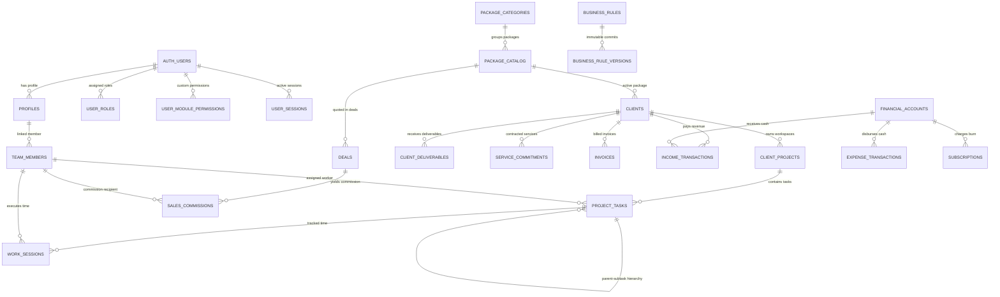

# SADA OS — Database Relationships & Cross-Module Dependencies

**Audit Date:** 2026-10-10  
**Scope:** Complete Foreign Key topology and architectural dependency graph.

---

## 1. Foreign Key Relationship Topology

The following table documents every foreign key relationship parsed from the migration DDL and enforced by PostgreSQL constraints:

| Source Table | Source Column | Target Table | Target Column | Cascading Rule |
| :--- | :--- | :--- | :--- | :--- |
| `profiles` | `id` | `auth` | `id` | Enforced by PostgreSQL |
| `user_roles` | `user_id` | `auth` | `id` | Enforced by PostgreSQL |
| `team_members` | `division` | `profiles` | `id` | Enforced by PostgreSQL |
| `team_members` | `user_id` | `auth` | `id` | Enforced by PostgreSQL |
| `testimonials` | `CONSTRAINT` | `clients` | `id` | Enforced by PostgreSQL |
| `testimonials` | `CONSTRAINT` | `projects` | `id` | Enforced by PostgreSQL |
| `contact_submissions` | `converted_project_id` | `client_projects` | `id` | Enforced by PostgreSQL |
| `contact_submissions` | `client_id` | `clients` | `id` | Enforced by PostgreSQL |
| `client_projects` | `contact_submission_id` | `contact_submissions` | `id` | Enforced by PostgreSQL |
| `client_projects` | `last_contact_date` | `profiles` | `id` | Enforced by PostgreSQL |
| `client_projects` | `lead_id` | `profiles` | `id` | Enforced by PostgreSQL |
| `client_projects` | `client_id` | `clients` | `id` | Enforced by PostgreSQL |
| `project_tasks` | `project_id` | `client_projects` | `id` | Enforced by PostgreSQL |
| `project_tasks` | `assignee_id` | `profiles` | `id` | Enforced by PostgreSQL |
| `project_tasks` | `service` | `profiles` | `id` | Enforced by PostgreSQL |
| `project_tasks` | `assigned_by_id` | `profiles` | `id` | Enforced by PostgreSQL |
| `project_tasks` | `client_id` | `clients` | `id` | Enforced by PostgreSQL |
| `project_tasks` | `package_id` | `packages` | `id` | Enforced by PostgreSQL |
| `project_tasks` | `CONSTRAINT` | `package_catalog` | `id` | Enforced by PostgreSQL |
| `project_tasks` | `workflow_template_id` | `workflow_templates` | `id` | Enforced by PostgreSQL |
| `project_tasks` | `commitment_id` | `service_commitments` | `id` | Enforced by PostgreSQL |
| `project_tasks` | `commitment_id` | `service_commitments` | `id` | Enforced by PostgreSQL |
| `project_tasks` | `deliverable_id` | `client_deliverables` | `id` | Enforced by PostgreSQL |
| `project_tasks` | `published_by` | `profiles` | `id` | Enforced by PostgreSQL |
| `project_tasks` | `created_by` | `profiles` | `id` | Enforced by PostgreSQL |
| `project_activity` | `project_id` | `client_projects` | `id` | Enforced by PostgreSQL |
| `project_activity` | `task_id` | `project_tasks` | `id` | Enforced by PostgreSQL |
| `project_activity` | `actor_id` | `profiles` | `id` | Enforced by PostgreSQL |
| `client_communication_logs` | `project_id` | `client_projects` | `id` | Enforced by PostgreSQL |
| `client_communication_logs` | `team_member_id` | `profiles` | `id` | Enforced by PostgreSQL |
| `client_communication_logs` | `client_id` | `clients` | `id` | Enforced by PostgreSQL |
| `clients` | `relationship_owner_id` | `profiles` | `id` | Enforced by PostgreSQL |
| `clients` | `monthly_package_price` | `team_members` | `id` | Enforced by PostgreSQL |
| `clients` | `account_manager_id` | `auth` | `id` | Enforced by PostgreSQL |
| `clients` | `package_id` | `packages` | `id` | Enforced by PostgreSQL |
| `clients` | `CONSTRAINT` | `package_catalog` | `id` | Enforced by PostgreSQL |
| `task_handoffs` | `task_id` | `project_tasks` | `id` | Enforced by PostgreSQL |
| `task_handoffs` | `project_id` | `client_projects` | `id` | Enforced by PostgreSQL |
| `task_handoffs` | `requested_by_id` | `profiles` | `id` | Enforced by PostgreSQL |
| `task_handoffs` | `from_assignee_id` | `profiles` | `id` | Enforced by PostgreSQL |
| `task_handoffs` | `to_assignee_id` | `profiles` | `id` | Enforced by PostgreSQL |
| `task_handoffs` | `assigner_id` | `profiles` | `id` | Enforced by PostgreSQL |
| `task_handoffs` | `rejected_by_id` | `profiles` | `id` | Enforced by PostgreSQL |
| `subscriptions` | `category_id` | `expense_categories` | `id` | Enforced by PostgreSQL |
| `salary_records` | `team_member_id` | `team_members` | `id` | Enforced by PostgreSQL |
| `salary_payments` | `team_member_id` | `team_members` | `id` | Enforced by PostgreSQL |
| `salary_payments` | `salary_record_id` | `salary_records` | `id` | Enforced by PostgreSQL |
| `salary_payments` | `created_by` | `profiles` | `id` | Enforced by PostgreSQL |
| `salary_payments` | `CONSTRAINT` | `salary_requests` | `id` | Enforced by PostgreSQL |
| `salary_requests` | `team_member_id` | `team_members` | `id` | Enforced by PostgreSQL |
| `salary_requests` | `reviewed_by` | `profiles` | `id` | Enforced by PostgreSQL |
| `salary_requests` | `salary_payment_id` | `salary_payments` | `id` | Enforced by PostgreSQL |
| `expense_transactions` | `category_id` | `expense_categories` | `id` | Enforced by PostgreSQL |
| `expense_transactions` | `subscription_id` | `subscriptions` | `id` | Enforced by PostgreSQL |
| `expense_transactions` | `salary_payment_id` | `salary_payments` | `id` | Enforced by PostgreSQL |
| `expense_transactions` | `team_member_id` | `team_members` | `id` | Enforced by PostgreSQL |
| `expense_transactions` | `client_id` | `clients` | `id` | Enforced by PostgreSQL |
| `expense_transactions` | `project_id` | `client_projects` | `id` | Enforced by PostgreSQL |
| `expense_transactions` | `created_by` | `profiles` | `id` | Enforced by PostgreSQL |
| `expense_transactions` | `allocation` | `sponsoring_campaigns` | `id` | Enforced by PostgreSQL |
| `income_transactions` | `client_id` | `clients` | `id` | Enforced by PostgreSQL |
| `income_transactions` | `project_id` | `client_projects` | `id` | Enforced by PostgreSQL |
| `income_transactions` | `created_by` | `profiles` | `id` | Enforced by PostgreSQL |
| `income_transactions` | `allocation` | `invoices` | `id` | Enforced by PostgreSQL |
| `financial_audit_logs` | `actor_id` | `profiles` | `id` | Enforced by PostgreSQL |
| `account_audit_logs` | `actor_id` | `auth` | `id` | Enforced by PostgreSQL |
| `invoices` | `client_id` | `clients` | `id` | Enforced by PostgreSQL |
| `invoices` | `project_id` | `client_projects` | `id` | Enforced by PostgreSQL |
| `invoices` | `created_by` | `profiles` | `id` | Enforced by PostgreSQL |
| `sponsoring_campaigns` | `client_id` | `clients` | `id` | Enforced by PostgreSQL |
| `sponsoring_campaigns` | `project_id` | `client_projects` | `id` | Enforced by PostgreSQL |
| `sponsoring_campaigns` | `invoice_id` | `invoices` | `id` | Enforced by PostgreSQL |
| `sponsoring_campaigns` | `created_by` | `profiles` | `id` | Enforced by PostgreSQL |
| `sales_commissions` | `team_member_id` | `team_members` | `id` | Enforced by PostgreSQL |
| `sales_commissions` | `client_id` | `clients` | `id` | Enforced by PostgreSQL |
| `sales_commissions` | `invoice_id` | `invoices` | `id` | Enforced by PostgreSQL |
| `sales_commissions` | `salary_payment_id` | `salary_payments` | `id` | Enforced by PostgreSQL |
| `sales_commissions` | `approved_by` | `profiles` | `id` | Enforced by PostgreSQL |
| `sales_commissions` | `deal_id` | `deals` | `id` | Enforced by PostgreSQL |
| `financial_closing_periods` | `closed_by` | `profiles` | `id` | Enforced by PostgreSQL |
| `financial_closing_periods` | `reopened_by` | `profiles` | `id` | Enforced by PostgreSQL |
| `deals` | `client_id` | `clients` | `id` | Enforced by PostgreSQL |
| `deals` | `package_id` | `packages` | `id` | Enforced by PostgreSQL |
| `deals` | `sales_owner_id` | `profiles` | `id` | Enforced by PostgreSQL |
| `deals` | `commission_recipient_id` | `team_members` | `id` | Enforced by PostgreSQL |
| `deals` | `CONSTRAINT` | `package_catalog` | `id` | Enforced by PostgreSQL |
| `deals` | `payment_status` | `deals` | `id` | Enforced by PostgreSQL |
| `client_deliverables` | `client_id` | `clients` | `id` | Enforced by PostgreSQL |
| `client_deliverables` | `package_id` | `packages` | `id` | Enforced by PostgreSQL |
| `client_deliverables` | `project_id` | `client_projects` | `id` | Enforced by PostgreSQL |
| `client_deliverables` | `CONSTRAINT` | `package_catalog` | `id` | Enforced by PostgreSQL |
| `production_bookings` | `client_id` | `clients` | `id` | Enforced by PostgreSQL |
| `production_bookings` | `deal_id` | `deals` | `id` | Enforced by PostgreSQL |
| `production_bookings` | `project_id` | `client_projects` | `id` | Enforced by PostgreSQL |
| `production_bookings` | `package_id` | `packages` | `id` | Enforced by PostgreSQL |
| `production_bookings` | `created_by` | `profiles` | `id` | Enforced by PostgreSQL |
| `production_bookings` | `CONSTRAINT` | `package_catalog` | `id` | Enforced by PostgreSQL |
| `work_sessions` | `team_member_id` | `team_members` | `id` | Enforced by PostgreSQL |
| `work_sessions` | `profile_id` | `profiles` | `id` | Enforced by PostgreSQL |
| `work_sessions` | `client_id` | `clients` | `id` | Enforced by PostgreSQL |
| `work_sessions` | `project_id` | `client_projects` | `id` | Enforced by PostgreSQL |
| `work_sessions` | `task_id` | `project_tasks` | `id` | Enforced by PostgreSQL |
| `notifications` | `user_id` | `auth` | `id` | Enforced by PostgreSQL |
| `notification_preferences` | `user_id` | `auth` | `id` | Enforced by PostgreSQL |
| `system_audit_logs` | `actor_id` | `auth` | `id` | Enforced by PostgreSQL |
| `package_catalog` | `category_id` | `package_categories` | `id` | Enforced by PostgreSQL |
| `package_catalog` | `created_by` | `profiles` | `id` | Enforced by PostgreSQL |
| `package_catalog` | `updated_by` | `profiles` | `id` | Enforced by PostgreSQL |
| `business_rules` | `updated_by` | `auth` | `id` | Enforced by PostgreSQL |
| `business_rule_versions` | `rule_id` | `business_rules` | `id` | Enforced by PostgreSQL |
| `business_rule_versions` | `changed_by` | `auth` | `id` | Enforced by PostgreSQL |
| `project_members` | `project_id` | `client_projects` | `id` | Enforced by PostgreSQL |
| `project_members` | `profile_id` | `profiles` | `id` | Enforced by PostgreSQL |
| `project_members` | `team_member_id` | `team_members` | `id` | Enforced by PostgreSQL |
| `workflow_stages` | `template_id` | `workflow_templates` | `id` | Enforced by PostgreSQL |
| `workflow_stages` | `default_assignee_id` | `profiles` | `id` | Enforced by PostgreSQL |
| `service_commitments` | `client_id` | `clients` | `id` | Enforced by PostgreSQL |
| `service_commitments` | `package_id` | `package_catalog` | `id` | Enforced by PostgreSQL |
| `service_commitments` | `assignee_id` | `profiles` | `id` | Enforced by PostgreSQL |
| `service_commitments` | `workflow_template_id` | `workflow_templates` | `id` | Enforced by PostgreSQL |
| `service_commitments` | `deliverable_id` | `client_deliverables` | `id` | Enforced by PostgreSQL |
| `user_module_permissions` | `user_id` | `auth` | `id` | Enforced by PostgreSQL |
| `reconciliation_audit_logs` | `client_id` | `clients` | `id` | Enforced by PostgreSQL |
| `reconciliation_audit_logs` | `deliverable_id` | `client_deliverables` | `id` | Enforced by PostgreSQL |
| `reconciliation_audit_logs` | `commitment_id` | `service_commitments` | `id` | Enforced by PostgreSQL |
| `reconciliation_audit_logs` | `task_id` | `project_tasks` | `id` | Enforced by PostgreSQL |
| `reconciliation_audit_logs` | `actor_id` | `profiles` | `id` | Enforced by PostgreSQL |
| `push_subscriptions` | `user_id` | `auth` | `id` | Enforced by PostgreSQL |
| `user_sessions` | `user_id` | `auth` | `id` | Enforced by PostgreSQL |
| `user_sessions` | `revoked_by` | `auth` | `id` | Enforced by PostgreSQL |
| `security_alerts` | `user_id` | `auth` | `id` | Enforced by PostgreSQL |
| `security_alerts` | `session_id` | `user_sessions` | `id` | Enforced by PostgreSQL |
| `security_alerts` | `resolved_by` | `auth` | `id` | Enforced by PostgreSQL |

---

## 2. Core Cross-Module Dependency Diagram

---

## 3. Critical Referential Invariants

1. **Delete Cascades Prohibited on Financial & Audit Entities**:
   - `income_transactions`, `expense_transactions`, `financial_accounts`, and `invoices` prohibit cascading hard deletes. If a client is removed or modified, financial transactions remain permanently preserved.
2. **Subtask Hierarchy Integrity**:
   - Subtasks in `project_tasks` reference `parent_task_id $\rightarrow$ project_tasks(id)`. Reassigning or updating a subtask never alters or auto-completes the parent task.
3. **Session Binding**:
   - `user_sessions` references `user_id $\rightarrow$ auth.users(id) ON DELETE CASCADE`.
4. **Audit Immutability**:
   - `system_audit_logs` and `account_audit_logs` do not permit foreign key cascades or deletes. Any `DELETE` or `UPDATE` statement triggers statement-level exception `P0001`.
