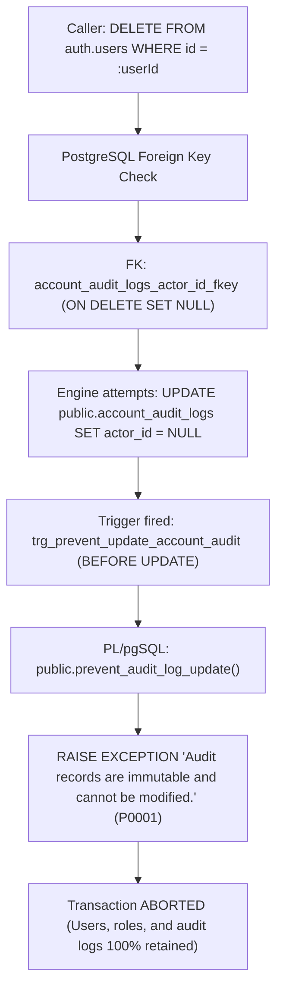
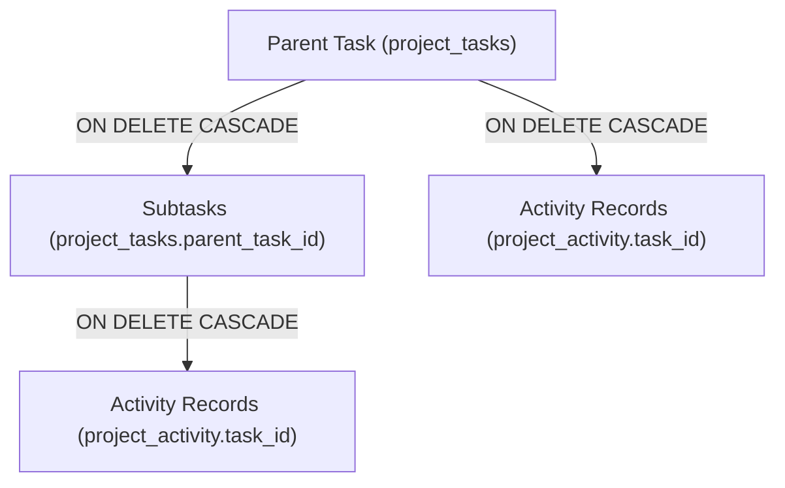
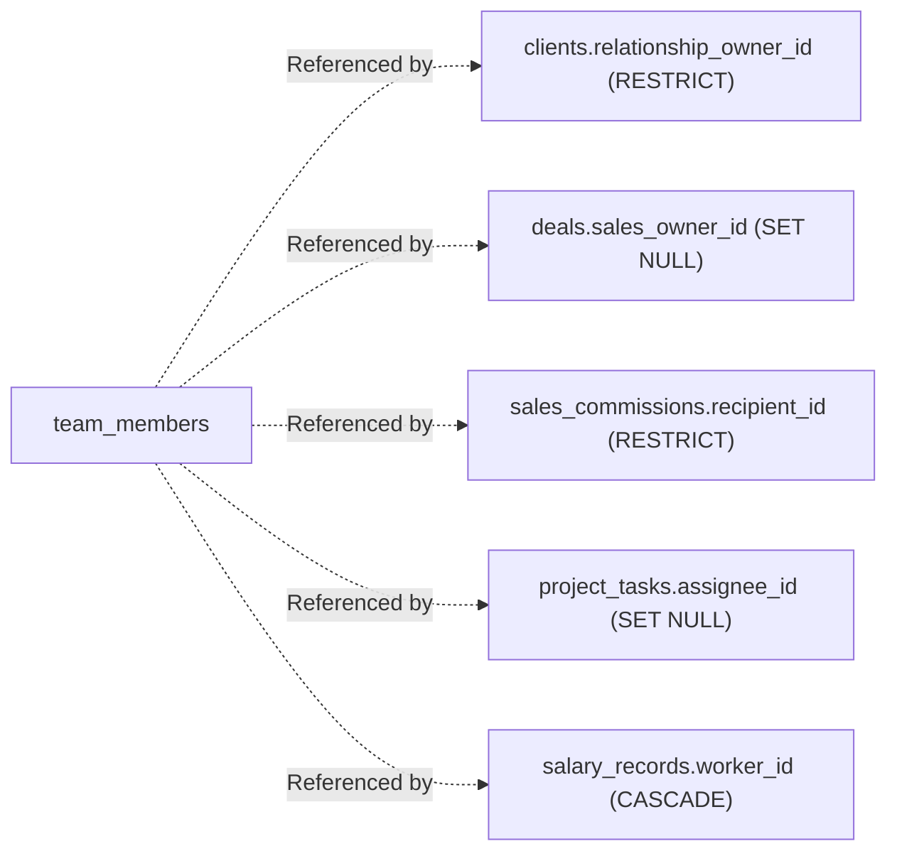
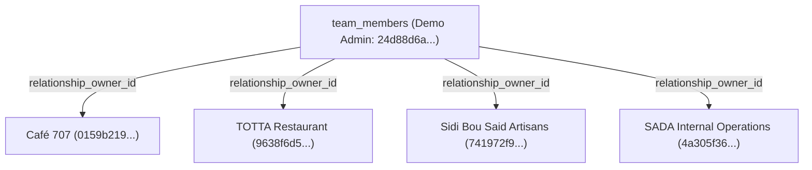
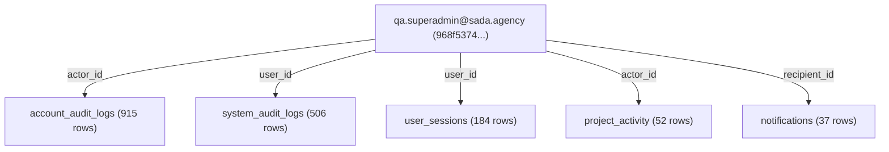
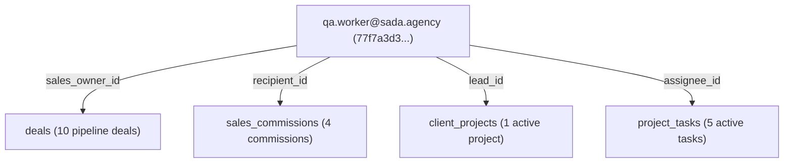

# SADA OS — Demo Data Dependency & Relational Constraints Map

**Document ID:** `SADA-CLEANUP-DEP-001`  
**Evaluation Standard:** Zero-Trust Dependency Modeling · Foreign-Key Integrity Verification  
**Audit Date:** October 14, 2026  
**Auditor:** Database Architect & Systems Reliability Engineer  
**Execution Status:** **READ-ONLY DISCOVERY COMPLETE — NO MUTATIONS EXECUTED**

---

## 1. Overview of Relational Constraints & Invariants

In the SADA OS PostgreSQL database schema, data integrity is governed by two layers of protection:
1. **Relational Constraints**: Declarative Foreign Keys with `ON DELETE CASCADE`, `ON DELETE SET NULL`, and `ON DELETE RESTRICT`.
2. **Immutable Audit Triggers**: Zero-trust PL/pgSQL statement-level triggers that abort transactions attempting to delete or modify historical compliance logs.

Before modifying or deleting any record, its complete foreign-key dependency tree must be verified to prevent database lockups, unhandled trigger exceptions, or orphaned relational references.

---

## 2. The Zero-Trust Audit Immutability Trigger Barrier

### 2.1 Trigger Execution Architecture

The primary blocker preventing hard-deletion of users who have ever performed an authenticated action or been targeted by an administrative RPC is the database immutability trigger:



### 2.2 DDL Evidence from PostgreSQL Migrations

From `supabase/migrations/20261010123000_audit_immutability_and_session_defense.sql`:

```sql
CREATE OR REPLACE FUNCTION public.prevent_audit_log_update()
RETURNS TRIGGER LANGUAGE plpgsql AS $$
BEGIN
    RAISE EXCEPTION 'Audit records are immutable and cannot be modified.';
END;
$$;

CREATE OR REPLACE FUNCTION public.prevent_audit_log_deletion()
RETURNS TRIGGER LANGUAGE plpgsql AS $$
BEGIN
    RAISE EXCEPTION 'Audit records are immutable and cannot be deleted.';
END;
$$;

CREATE TRIGGER trg_prevent_update_account_audit
    BEFORE UPDATE ON public.account_audit_logs
    FOR EACH STATEMENT
    EXECUTE FUNCTION public.prevent_audit_log_update();

CREATE TRIGGER trg_prevent_delete_account_audit
    BEFORE DELETE ON public.account_audit_logs
    FOR EACH STATEMENT
    EXECUTE FUNCTION public.prevent_audit_log_deletion();
```

### 2.3 Operational Consequence
- **Any user who has rows in `public.account_audit_logs` CANNOT be deleted from `auth.users` via standard SQL cascade.**
- Attempting to delete `account_audit_logs` is also blocked by `trg_prevent_delete_account_audit`.
- **Conclusion:** Bypassing this trigger or attempting to drop audit logs violates compliance and security requirements. For all accounts with audit logs (such as the 14 `PhaseE` team members), **soft-deactivation (`is_active = false`) is the only valid and safe operation**.

---

## 3. Entity-by-Entity Dependency Analysis

### 3.1 Project Tasks (`public.project_tasks`)



- **Inbound Foreign Keys:** None for test tasks (no invoices, deals, or financial records reference test tasks).
- **Outbound Foreign Keys:**
  - `project_id -> client_projects(id)` (Nullable/Optional)
  - `assignee_id -> team_members(id)` (Nullable)
  - `parent_task_id -> project_tasks(id)` (`ON DELETE CASCADE`)
- **Downstream Cascades:**
  - `public.project_activity`: Has foreign key `task_id -> project_tasks(id) ON DELETE CASCADE`.
  - Critically, `project_activity` does **NOT** have immutable audit triggers.
- **Safe Deletion Sequence:**
  1. Delete child subtasks first (`WHERE parent_task_id IS NOT NULL`).
  2. Delete parent tasks second (`WHERE parent_task_id IS NULL`).
  3. Delete standalone E2E verified and calendar tasks.
- **Safety Verdict:** **100% SAFE TO DELETE** in the correct sequence. Cascades cleanly without errors.

---

### 3.2 Team Members (`public.team_members`)



#### Detailed Dependency Audit of the 14 Oct 14 Test Members:
An empirical dependency query across all 19 database tables verified the references for the 14 `PhaseE` team member UUIDs:
- `clients.relationship_owner_id`: **0 rows**.
- `deals.sales_owner_id`: **0 rows**.
- `sales_commissions.recipient_id`: **0 rows**.
- `client_projects.lead_id`: **0 rows**.
- `salary_records.worker_id`: **0 rows**.
- `salary_payments.worker_id`: **0 rows**.
- `work_sessions.worker_id`: **0 rows**.
- `project_tasks.assignee_id`: Referenced only by the 18 disposable test tasks.
- `account_audit_logs.target_user_id`: Exactly 1 row per member (`account_created`).

#### Safety Verdict:
Because each member is referenced in `public.account_audit_logs`, hard deletion is blocked by PostgreSQL. Soft-deactivating these 14 members (`is_active = false`) has **zero downstream blockers** and immediately updates the active member metric from 381 to 367.

---

### 3.3 Clients & Commercial Relationships (`public.clients`)



- **Critical Dependency Identified:**
  The account `demo.admin.test.1790932428778@sada.agency` (`d620961d-52bb...`) has linked team member `Demo Admin Tester` (`24d88d6a-968b-4481-be5a-ee3402019c77`).
- Team member `24d88d6a-...` is recorded as the canonical `relationship_owner_id` for **4 genuine commercial clients**:
  1. `Café 707` (`0159b219-605e-4020-9d73-34117263541e`)
  2. `TOTTA Restaurant` (`9638f6d5-a88a-48e3-9980-0ce7064ea352`)
  3. `Sidi Bou Said Artisans` (`741972f9-0bba-4181-acfe-05e6660699ff`)
  4. `SADA Internal Operations` (`4a305f36-3acb-4476-987a-8a0ed62ec246`)
- **Safety Verdict:**
  Attempting to delete team member `24d88d6a-...` or user `d620961d-...` would either be rejected by foreign-key constraints or orphan the relationship owner on these active client accounts. **This account and team member MUST BE RETAINED INTACT.**

---

### 3.4 Root Super Admin Account (`qa.superadmin@sada.agency`)



- **Critical Dependency Identified:**
  `qa.superadmin@sada.agency` (`968f5374-4ad0-4bf1-a2db-338d6b5491e5`) is the historical administrative principal that executed migrations, account setups, and system audits.
- It is bound to:
  - **915 rows** in `public.account_audit_logs` (immutable trigger active).
  - **506 rows** in `public.system_audit_logs` (immutable audit history).
  - **184 rows** in `public.user_sessions`.
  - **52 rows** in `public.project_activity`.
- **Safety Verdict:**
  Any attempt to delete this account is irreversibly blocked by database triggers and would corrupt historical provenance. **This account MUST BE RETAINED INTACT.**

---

### 3.5 Sales Worker Account (`qa.worker@sada.agency`)



- **Critical Dependency Identified:**
  `qa.worker@sada.agency` (`77f7a3d3-82c1-4744-8f01-0a1fd5f44bba`) is linked to team member `9c0937f7-4617-4803-b718-a3d9a5175dd9`.
- It holds:
  - **10 pipeline deals** in `public.deals`.
  - **4 sales commissions** in `public.sales_commissions`.
  - **1 active project lead assignment** in `public.client_projects`.
  - **5 deliverables** in `public.project_tasks`.
- **Safety Verdict:**
  Deleting this account would delete or corrupt active pipeline deals and commission records. **This account MUST BE RETAINED INTACT.**

---

## 4. Comprehensive Safety Classification Matrix

| Entity | UUID / Scope | Primary Dependencies | Immutability Trigger Protection | Safe Action | Risk If Wrong Action Taken |
| :--- | :--- | :--- | :---: | :---: | :--- |
| **Protected Real Accounts** | 3 accounts (`boubakar.*`, `boubakarhamedsgail.*`, `rbs.*`) | Platform owner identity, permissions, project leads | Enforced | **RETAIN (NO TOUCH)** | Loss of system ownership and administrative access |
| **Oct 14 Test Tasks** | 18 task UUIDs | `project_activity` (cascades) | None | **DELETE** | None (cleans overdue and active deliverable metrics) |
| **Oct 14 Team Members** | 14 member UUIDs | `account_audit_logs` (16 rows) | Active (P0001 on delete) | **SOFT-DEACTIVATE** | Transaction aborted if hard delete attempted |
| **Oct 14 E2E Admin Users** | 2 user UUIDs (`fee33ab8...`, `31442d0d...`) | `profiles`, `user_roles` | None | **DEACTIVATE ROLES & PROFILES** | Can be cleanly deactivated; auth.users deletion irreversible |
| **Oct 14 Test Notifications** | 2 verified notification UUIDs (58 retained) | User / task references | None | **DELETE 2 VERIFIED ROWS; RETAIN 58** | Broad date filter would delete 11 real alerts on protected accounts |
| **Historical Demo Admin** | `demo.admin.test.*` (`d620961d...`) | 4 Client relationship owners | Foreign Key Restrict | **RETAIN** | Orphans relationship owner on 4 real clients |
| **QA Super Admin** | `qa.superadmin@sada.agency` | 915 audit logs, 506 system logs | Active (P0001 on delete) | **RETAIN** | Transaction aborts; irreversible audit log lockup |
| **QA Sales Worker** | `qa.worker@sada.agency` | 10 deals, 4 commissions, 1 project | Foreign Key Restrict | **RETAIN** | Deletes sales deals and commission transactions |
| **Canonical Financial Baseline** | 6 clients, 6 invoices, 5 campaigns | Unified financial ledger | Foreign Key Restrict | **RETAIN** | Destroys reconciled Client Workspaces financial baseline |
