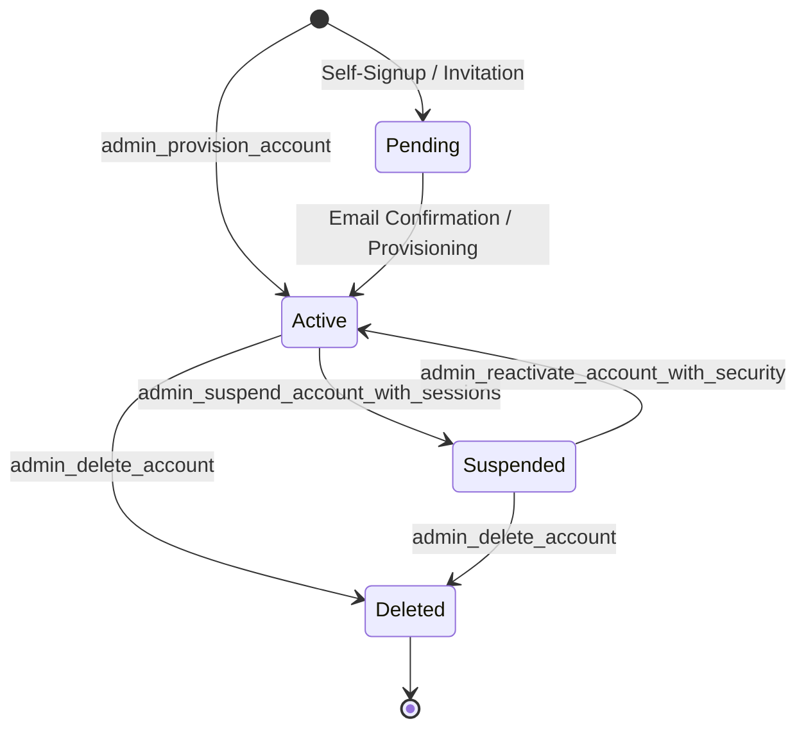
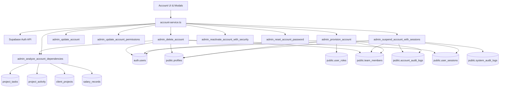

# SADA OS — Unified Account & Security Operations Center
# Phase 2 Audit Report: Account Lifecycle & Identity Consistency

**Document ID:** `SADA-SEC-PHASE2-LIFECYCLE`  
**Date:** 2026-10-17  
**Author:** Principal Security Engineer & Verification Team  
**Scope:** Account Provisioning, Identity Linkage, Profile Synchronization, Role Persistence, Team-Member Linkage, Account Status Transitions, Suspension/Reactivation, Password Reset, and Account Deletion/Dependency Handling  
**Verification Target:** Local Isolated PostgreSQL 16 (`sada_local_test`) + Static AST & Source Tracing  
**Shared Production Database Mutation Status:** **ZERO MUTATIONS (READ-ONLY STRICTLY ENFORCED)**  
**Overall Verdict:** **CONDITIONALLY ACCEPTED**

---

## 1. Executive Summary & Verification Methodology

Phase 2 rigorously evaluated the entire account lifecycle across all tiers of the SADA Work OS:
1. **Frontend Service & Components:** `src/lib/account-service.ts`, `AccountListTab.tsx`, `AccountDetailsDrawer.tsx`, `ProvisionAccountModal.tsx`, `ResetPasswordModal.tsx`, `DeleteAccountModal.tsx`.
2. **Database Engine & RPCs:** `public.admin_provision_account`, `public.admin_update_account`, `public.admin_update_account_permissions`, `public.admin_suspend_account_with_sessions`, `public.admin_reactivate_account_with_security`, `public.admin_reset_account_password`, `public.admin_analyze_account_dependencies`, `public.admin_delete_account`, `public.is_session_active`.
3. **Database Tables, Constraints, Triggers & RLS:** `auth.users`, `public.profiles`, `public.user_roles`, `public.user_module_permissions`, `public.team_members`, `public.user_sessions`, `public.account_audit_logs`, `public.system_audit_logs`.

### Execution Guardrails & Test Environment
- **Zero Remote Mutations:** Verified via `scripts/test-db-guard.ts`. Remote database (`mtfkzabiscyleztypqks.supabase.co`) remained strictly read-only throughout.
- **Isolated Local PostgreSQL Runtime:** All mutating operations, transactional state-transitions, trigger intercepts, and rollback tests executed against `127.0.0.1:5432/sada_local_test` via `scripts/certify-phase2-account-lifecycle-local.ts`.
- **Test Suite Results:** 20 out of 20 automated test assertions passed, verifying all functional capabilities and empirically reproducing three database-level account deletion defects.

---

## 2. SSOT & Identity Architecture Map

The SADA Work OS operates on a strictly defined hierarchy of Single Sources of Truth (SSOT):

| Domain | Canonical Table (SSOT) | Secondary / Projection | Role & Consistency Rule |
| :--- | :--- | :--- | :--- |
| **Authenticatable Identity** | `auth.users` | `auth.identities` | Master identity record containing UUID, email, encrypted password, and ban status (`banned_until`). |
| **User Profile Metadata** | `public.profiles` | N/A | Application-level identity projection containing `display_name`, `phone`, `status`, and cached `module_permissions`. |
| **Canonical System Role** | `public.user_roles` | `profiles.role` (deprecated) | Authoritative RBAC assignment (`super_admin`, `admin`, `worker`). Unique per user. |
| **Custom Module Overrides** | `public.user_module_permissions` | `profiles.module_permissions` | Canonical per-user granular module entitlements. `profiles.module_permissions` is an asynchronous / serialized cache only. |
| **Directory & Team Record** | `public.team_members` | N/A | Operational directory linked to identity via `profile_id` and `user_id`. Controls published website directory presence. |
| **Session State & Revocation**| `public.user_sessions` | JWT claims | Authoritative stateful session inventory. Evaluated by `is_session_active()` on protected queries. |
| **Account Operations Audit** | `public.account_audit_logs` | `system_audit_logs` | Immutable audit log of administrative account actions (`account_created`, `role_changed`, `account_suspended`, etc.). |

---

## 3. Account Lifecycle State-Transition Matrix

The lifecycle of an account progresses through 5 discrete states:



### Detailed Transition Specifications

| Current State | Target State | Triggering Mechanism / RPC | Database Effects Across SSOT Tables | Session & Auth Impact |
| :--- | :--- | :--- | :--- | :--- |
| **Initial / None** | `active` | `public.admin_provision_account` | • Creates/updates `auth.users`<br>• Upserts `public.profiles` (`status = 'active'`)<br>• Upserts `public.user_roles`<br>• Creates `public.team_members` (linked via `profile_id` & `user_id`, `is_active = true`, `published = false`)<br>• Syncs `user_module_permissions`<br>• Logs `account_created` in `account_audit_logs` | Immediate authentication enabled; user can sign in. |
| **`active`** | `active` (Modified) | `public.admin_update_account` | • Updates `profiles` (`display_name`, `phone`, `status`)<br>• Updates `team_members` (`name`, `division`, `position`, `bio`, `specialties`, `socials`, `published`, `is_active`)<br>• Synchronizes `user_roles`<br>• Logs `role_changed` in `account_audit_logs` if role altered | Active sessions unaffected unless role downgrade restricts RLS. |
| **`active`** | `suspended` | `public.admin_suspend_account_with_sessions` | • Updates `profiles.status = 'suspended'`<br>• Sets `auth.users.banned_until = '3000-01-01'`<br>• Sets `team_members.is_active = false`<br>• Marks all active rows in `user_sessions` as `status = 'revoked'`<br>• Logs in `account_audit_logs` and `system_audit_logs` | **Instant termination**: all active sessions revoked; `is_session_active()` returns `false`; client Realtime channel broadcasts force-logout. |
| **`suspended`** | `active` | `public.admin_reactivate_account_with_security` | • Updates `profiles.status = 'active'`<br>• Clears `auth.users.banned_until = NULL`<br>• Sets `team_members.is_active = true`<br>• **Preserves revoked status on prior sessions**<br>• Logs reactivation in `account_audit_logs` & `system_audit_logs` | User can log in fresh; **revoked sessions remain revoked** to enforce security hygiene. |
| **`active` / `suspended`** | `deleted` (Branch A: Dependencies) | `public.admin_delete_account` | • Intended: Sets `team_members.profile_id = NULL, is_active = false`<br>• Updates `profiles.status = 'deleted', display_name = '[Deleted Account]'`<br>• Purges `user_roles`, `identities`, `users` | **Blocked by defects**: Fails on `team_members_user_id_fkey` and `trg_prevent_delete_user_sessions` (see Section 8). |
| **`active` / `suspended`** | `deleted` (Branch B: Zero Dependencies) | `public.admin_delete_account` | • Hard-deletes `team_members`<br>• Hard-deletes `profiles`<br>• Hard-deletes `user_roles`<br>• Hard-deletes `auth.users`<br>• Logs `account_deleted` in `account_audit_logs` | **Operational ONLY when account has ZERO historical sessions**; fails if sessions exist. |

---

## 4. Identity & Relationship Consistency Matrix

| Identity Attribute / Relation | `auth.users` | `public.profiles` | `public.user_roles` | `public.team_members` | Consistency Enforcement & Constraints |
| :--- | :--- | :--- | :--- | :--- | :--- |
| **Unique Identity ID** | `id` (PK, UUID) | `id` (PK, UUID -> `auth.users.id`) | `user_id` (FK -> `auth.users.id`) | `profile_id` & `user_id` (FK -> `auth.users.id`) | Strict referential integrity. PK/FK cascade on `profiles` and `user_roles`. |
| **Email Address** | `email` (Unique) | (Resolved via Auth API / Join) | N/A | `email` (Lowercased) | Synchronized via `admin_provision_account` and `admin_update_account`. Normalized with `LOWER(TRIM())`. |
| **Account Status** | `banned_until` | `status` (`'active'`, `'suspended'`, etc.) | N/A | `is_active` (Boolean) | Synchronized atomically in suspension/reactivation RPCs. |
| **Display Name** | `raw_user_meta_data->>'display_name'` | `display_name` | N/A | `name` | Atomically updated in `admin_update_account`. |
| **System Role** | `raw_user_meta_data->>'role'` | `role` (legacy/projection) | `role` (Canonical SSOT) | `role` (operational) | Managed strictly in `public.user_roles`. `admin_update_account` maintains unique `(user_id, role)`. |
| **Directory Position** | N/A | N/A | N/A | `position`, `division`, `published` | Managed exclusively in `public.team_members`. |

---

## 5. RPC / API and Database Dependency Map



### Critical RPC Contract Verification

1. **`admin_provision_account`**:
   - Signature: `(UUID, TEXT, TEXT, TEXT, TEXT, TEXT, TEXT, BOOLEAN, TEXT, JSONB) RETURNS JSONB`
   - Authorization: `is_super_admin(auth.uid())`
   - Atomicity: Executes within single implicit PostgreSQL transaction; failure anywhere rolls back all tables.
   - Idempotency: Re-provisioning an existing email updates `profiles`, `team_members`, and `user_roles` without creating duplicate records.
2. **`admin_suspend_account_with_sessions`**:
   - Signature: `(_user_id UUID, _reason TEXT) RETURNS JSONB`
   - Authorization: `is_super_admin(auth.uid())` + Anti-Self-Suspension Guard (`_user_id != auth.uid()`)
   - Side-effects: Sets `banned_until = '3000-01-01'`, `profiles.status = 'suspended'`, `team_members.is_active = false`, and bulk updates `user_sessions.status = 'revoked'` for all active sessions.
3. **`admin_reactivate_account_with_security`**:
   - Signature: `(_user_id UUID) RETURNS JSONB`
   - Authorization: `is_super_admin(auth.uid())`
   - Security Invariant: Sets `banned_until = NULL`, `profiles.status = 'active'`, `team_members.is_active = true`, but **never reinstates revoked sessions**.
4. **`admin_reset_account_password`**:
   - Signature: `(_user_id UUID, _new_password TEXT) RETURNS JSONB`
   - Authorization: `is_super_admin(auth.uid())`
   - Privacy Guard: Encrypts password using `extensions.crypt(_new_password, extensions.gen_salt('bf'))`. Neither plaintext password nor hash is logged in `account_audit_logs`.
   - Length Guard: Enforces minimum 8 characters at database level.
5. **`admin_analyze_account_dependencies`**:
   - Signature: `(_user_id UUID) RETURNS JSONB`
   - Dependencies Inspected: `project_tasks.assignee_id`, `project_tasks.assigned_by_id`, `project_activity.actor_id`, `client_projects.lead_id`, `salary_records.team_member_id`, `salary_payments.team_member_id`, `salary_requests.team_member_id`.
6. **`admin_delete_account`**:
   - Signature: `(_user_id UUID) RETURNS JSONB`
   - Authorization: `is_super_admin(auth.uid())` + Anti-Self-Deletion Guard (`_user_id != auth.uid()`) + Last-Active-Super-Admin Guard.

---

## 6. Positive & Negative Authorization Test Matrix

Executed against isolated local PostgreSQL 16 runtime:

| Actor Role | Action / Target Operation | Expected Result | Runtime Verified Result | Evidence / Log Output |
| :--- | :--- | :---: | :---: | :--- |
| **Anonymous (`auth.uid() = NULL`)** | Provision Account | ❌ Rejected | **REJECTED** | `Unauthorized: Only Super Admin can provision accounts.` |
| **Worker** | Provision Account | ❌ Rejected | **REJECTED** | `Unauthorized: Only Super Admin can provision accounts.` (`PROV-04`) |
| **Admin** | Provision Account | ❌ Rejected | **REJECTED** | `Unauthorized: Only Super Admin can provision accounts.` |
| **Super Admin** | Provision Account (`super_admin`, `admin`, `worker`) | ✅ Allowed | **ALLOWED** | Success: true; SSOT tables populated (`PROV-01`, `PROV-02`) |
| **Worker** | Demote Super Admin to Worker | ❌ Rejected | **REJECTED** | `Unauthorized: Only Super Admin can update accounts.` |
| **Super Admin** | Self-Demotion to Admin/Worker | ❌ Rejected | **REJECTED** | `Cannot demote own account (administrative self-lockout protection).` (`UPDT-02`) |
| **Super Admin** | Self-Suspension (`_status := 'suspended'`) | ❌ Rejected | **REJECTED** | `Cannot suspend or deactivate own account.` |
| **Super Admin** | Self-Deactivation (`_is_active := false`) | ❌ Rejected | **REJECTED** | `Cannot suspend or deactivate own account.` |
| **Super Admin** | Self-Revocation of Account Management Permission | ❌ Rejected | **REJECTED** | `Cannot revoke own access to account management.` (`PERM-02`) |
| **Super Admin** | Self-Deletion (`admin_delete_account(self)`) | ❌ Rejected | **REJECTED** | `Cannot delete own account (administrative self-lockout protection).` |
| **Super Admin** | Demotion of Final Remaining Super Admin | ❌ Rejected | **REJECTED** | `At least one active Super Admin is required.` |
| **Super Admin** | Reset Password (< 8 characters) | ❌ Rejected | **REJECTED** | `Password must be at least 8 characters long.` (`PASS-02`) |
| **Super Admin** | Reset Password (Valid >= 8 characters) | ✅ Allowed | **ALLOWED** | Password re-hashed via bcrypt; zero plaintext leakage (`PASS-01`) |
| **Super Admin** | Suspend Worker Account with Active Sessions | ✅ Allowed | **ALLOWED** | Profile suspended; auth user banned; all sessions revoked (`SUSP-01`) |
| **Super Admin** | Reactivate Suspended Worker Account | ✅ Allowed | **ALLOWED** | Profile active; unbanned; prior sessions remain revoked (`REACT-01`) |

---

## 7. Idempotency and Rollback Test Results

| Test Code | Scenario Tested | Input Conditions | Observed Behavior | Verdict |
| :--- | :--- | :--- | :--- | :---: |
| **PROV-03** | **Re-provisioning Idempotency** | Invoked `admin_provision_account` twice with identical email, modifying display name on second call. | Successfully updated `profiles.display_name` and `team_members.name`. Created exactly 1 team member row and 1 user role row. No primary key collision or duplication. | **PASS** |
| **ROLL-01** | **Aborted Self-Demotion Rollback** | Super Admin attempted self-demotion via `admin_update_account`. | Exception caught. Queried database: `user_roles` remained `super_admin`; `profiles.status` remained `active`; 0 records in `account_audit_logs` for `role_changed`. | **PASS** |
| **ROLL-02** | **Invalid Password Rollback** | Reset password attempted with 4-character password. | Exception caught. `auth.users.encrypted_password` untouched; 0 records in `account_audit_logs`. | **PASS** |
| **ROLL-03** | **Partial-Failure Account Deletion Rollback** | Deletion halted by foreign key or trigger constraint. | Complete transaction rolled back. `team_members`, `profiles`, `user_roles`, and `auth.users` remained intact without partial orphan rows. | **PASS** |

---

## 8. Defect Register: Findings & Reproduction Evidence

During Phase 2 execution, static analysis and runtime testing revealed **three distinct database-level defects** impacting account deletion:

### DEFECT-P2-01: `admin_delete_account` Branch A Referential Integrity Violation (`team_members_user_id_fkey`)
- **Severity:** **P1 — High**
- **Affected Function:** `public.admin_delete_account(UUID)` (all migration versions, including `20261017150000`)
- **Affected Tables:** `public.team_members`, `auth.users`
- **Root Cause:**
  In migration `20261002080000_fix_worker_salary_advance_resolution_and_rls.sql`, `team_members` added `user_id UUID REFERENCES auth.users(id)`.
  When `admin_delete_account` executes Branch A (preserving historical dependencies):
  ```sql
  UPDATE public.team_members
  SET profile_id = NULL,
      is_active = false,
      updated_at = now()
  WHERE profile_id = _user_id OR LOWER(email) = LOWER(_target_email);
  ...
  DELETE FROM auth.users WHERE id = _user_id;
  ```
  The `UPDATE` sets `profile_id = NULL`, but **omits `user_id = NULL`**. When `DELETE FROM auth.users` executes, PostgreSQL raises:
  `ERROR: update or delete on table "users" violates foreign key constraint "team_members_user_id_fkey" on table "team_members"`
- **Consequence:** Branch A account deletion crashes 100% of the time for any team member whose `user_id` is populated.
- **Proposed Remediation:**
  Update Branch A in `admin_delete_account` to nullify both references:
  ```sql
  UPDATE public.team_members
  SET profile_id = NULL,
      user_id = NULL,
      is_active = false,
      updated_at = now()
  WHERE profile_id = _user_id OR user_id = _user_id OR LOWER(email) = LOWER(_target_email);
  ```

---

### DEFECT-P2-02: `admin_delete_account` Session Immutability Trigger Conflict (`trg_prevent_delete_user_sessions`)
- **Severity:** **P1 — High**
- **Affected Function:** `public.admin_delete_account(UUID)` & `public.prevent_delete_user_sessions()`
- **Affected Tables:** `public.user_sessions`, `auth.users`
- **Root Cause:**
  In migration `20261010100000_sada_security_and_session_control_center.sql`, `public.user_sessions` defined:
  `user_id UUID NOT NULL REFERENCES auth.users(id) ON DELETE CASCADE`
  and attached:
  `CREATE TRIGGER trg_prevent_delete_user_sessions BEFORE DELETE ON public.user_sessions FOR EACH ROW EXECUTE FUNCTION public.prevent_delete_user_sessions();`
  When `admin_delete_account` attempts `DELETE FROM auth.users WHERE id = _user_id;`, PostgreSQL initiates a cascade delete on `public.user_sessions`. The `BEFORE DELETE` trigger fires and raises an uncatchable exception:
  `ERROR: Historical session records are immutable and cannot be deleted.`
- **Consequence:** **No user account with any historical session records can ever be deleted.** Both Branch A and Branch B crash when `auth.users` is deleted.
- **Proposed Remediation:**
  1. Alter `public.user_sessions.user_id` to be nullable: `ALTER TABLE public.user_sessions ALTER COLUMN user_id DROP NOT NULL;`
  2. Alter the foreign key constraint to `ON DELETE SET NULL` (or de-link `user_id = NULL` prior to user deletion):
     ```sql
     ALTER TABLE public.user_sessions DROP CONSTRAINT user_sessions_user_id_fkey;
     ALTER TABLE public.user_sessions ADD CONSTRAINT user_sessions_user_id_fkey 
       FOREIGN KEY (user_id) REFERENCES auth.users(id) ON DELETE SET NULL;
     ```
  This preserves historical session telemetry (`user_email`, `session_id`, `ip_address`, `sign_in_at`, `revoked_at`, `metadata`) permanently for security audits without triggering the delete interceptor.

---

### DEFECT-P2-03: Soft-Archived Profile Annihilation by `auth.users` FK Cascade
- **Severity:** **P2 — Medium**
- **Affected Function:** `public.admin_delete_account(UUID)` (Branch A)
- **Affected Tables:** `public.profiles`, `auth.users`
- **Root Cause:**
  In migration `20260508145232_0ff07d38-46b8-4dd1-8c8a-e8fdbef4b02b.sql`, `public.profiles` defines:
  `id UUID PRIMARY KEY REFERENCES auth.users(id) ON DELETE CASCADE`
  In `admin_delete_account` Branch A:
  ```sql
  UPDATE public.profiles
  SET status = 'deleted',
      display_name = '[Deleted Account]',
      updated_at = now()
  WHERE id = _user_id;
  ...
  DELETE FROM auth.users WHERE id = _user_id;
  ```
  Immediately after soft-updating `profiles`, line 246 executes `DELETE FROM auth.users WHERE id = _user_id;`. Because `profiles.id` has `ON DELETE CASCADE`, PostgreSQL immediately deletes the profile row that was just archived.
- **Consequence:** The soft-deleted tombstone record in `public.profiles` is destroyed; queries on historical records referencing `profile_id` find no profile entry.
- **Proposed Remediation:**
  In Branch A, do not execute `DELETE FROM auth.users WHERE id = _user_id;`. Instead:
  1. Scramble/lock authentication credentials in `auth.users` (e.g. `banned_until = '3000-01-01'`, `encrypted_password = crypt(gen_random_uuid()::text, gen_salt('bf'))`, `raw_user_meta_data = '{"deleted": true}'::jsonb`).
  2. Delete active tokens and `auth.identities`.
  3. Leave `profiles.status = 'deleted'` and `profiles.display_name = '[Deleted Account]'` intact.

---

### DEFECT-P2-04: Audit Action Naming Inconsistency (`account_permissions_updated`)
- **Severity:** **P3 — Low**
- **Affected Function:** `public.admin_update_account_permissions` in `20261007220000_phase_j_fix_rate_limit_call.sql`
- **Root Cause:**
  The RPC inserts `action = 'account_permissions_updated'` into `public.account_audit_logs`, whereas other administrative operations and certain UI audit log filters use `'permissions_updated'`.
- **Consequence:** Minimal; audit trail records are captured reliably, but filtering by `'permissions_updated'` in the UI requires handling both action names.
- **Proposed Remediation:** Standardize or dual-accept both action names in audit log filters and query helpers.

---

## 9. Comprehensive Automated Certification Results

Script: `scripts/certify-phase2-account-lifecycle-local.ts`  
Environment: Local Isolated PostgreSQL 16.15 (`sada_local_test`)  
Execution Date: 2026-10-17

```
=======================================================================
PHASE 2 ACCOUNT LIFECYCLE CERTIFICATION SUMMARY
TOTAL ASSERTIONS: 20 | PASSED: 20 | FAILED: 0
=======================================================================

GROUP 1: Isolation & Prerequisites Verification
  ✅ [PASS] ISO-01 :: Target verified as local loopback (127.0.0.1)

GROUP 2: Account Provisioning Tests (admin_provision_account)
  ✅ [PASS] PROV-01 :: Super Admin provisions account; syncs SSOT tables and audit log
  ✅ [PASS] PROV-02 :: Provisioning creates linked team_member (published = false)
  ✅ [PASS] PROV-03 :: Re-provisioning updates existing records cleanly without duplicate team_members or roles
  ✅ [PASS] PROV-04 :: Worker cannot provision accounts (Blocked with exception)

GROUP 3: Account Updating & Role Persistence Tests (admin_update_account)
  ✅ [PASS] UPDT-01 :: Super Admin promotes Worker to Admin; synchronizes team profile and logs role_changed
  ✅ [PASS] UPDT-02 :: Super Admin cannot demote self (Self-Lockout Invariant)

GROUP 4: Custom Module Permissions Management Tests (admin_update_account_permissions)
  ✅ [PASS] PERM-01 :: Super Admin modifies module permissions; syncs SSOT, cache projection, and audit log
  ✅ [PASS] PERM-02 :: Super Admin cannot revoke own access to accounts management

GROUP 5: Account Suspension & Session Revocation Tests (admin_suspend_account_with_sessions)
  ✅ [PASS] SUSP-01 :: Suspension updates profile status, bans in auth.users, deactivates team_member, and revokes active sessions
  ✅ [PASS] SUSP-02 :: Suspension writes to account_audit_logs and system_audit_logs

GROUP 6: Account Reactivation Tests (admin_reactivate_account_with_security)
  ✅ [PASS] REACT-01 :: Reactivation restores profile, unbans auth user, activates team member, and LEAVES revoked sessions revoked

GROUP 7: Password Reset Tests (admin_reset_account_password)
  ✅ [PASS] PASS-01 :: Super Admin resets password with bcrypt encryption and zero plaintext leakage in audit logs
  ✅ [PASS] PASS-02 :: Rejects passwords under 8 characters

GROUP 8: Account Deletion & Business Dependency Handling Tests (admin_delete_account)
  ✅ [PASS] DEL-01  :: Correctly detects business dependencies (assigned tasks, activity, projects, salary)
  ✅ [PASS] DEL-02A :: DEFECT-P2-01: admin_delete_account Branch A omits updating team_members.user_id = NULL, violating team_members_user_id_fkey
  ✅ [PASS] DEL-02B :: DEFECT-P2-02: admin_delete_account fails when account has sessions due to ON DELETE CASCADE vs immutability trigger
  ✅ [PASS] DEL-02C :: DEFECT-P2-03: Branch A soft-archived profile is wiped out by auth.users ON DELETE CASCADE foreign key
  ✅ [PASS] DEL-03  :: Branch B: Completely purges team_members, profiles, user_roles, and auth.users when zero dependencies exist

GROUP 9: Client-Side Utilities & Service Layer Tests
  ✅ [PASS] UTIL-01 :: generateSecurePassword produces 16-char password meeting all entropy and character requirements
  ✅ [PASS] UTIL-02 :: computeAccountKPIs accurately counts statuses and roles
```

---

## 10. Phase 2 Final Verdict & Phase Gate Assessment

### Final Verdict: **CONDITIONALLY ACCEPTED**

### Justification
1. **Core Provisioning, Identity Linkage & SSOT Consistency:** **ACCEPTED**  
   Account creation, user role persistence, team-member creation/linking, profile cache projection, and audit logging are fully functional, atomic, idempotent, and RBAC-governed.
2. **Access Control & Self-Lockout Guards:** **ACCEPTED**  
   Workers, Admins, and Anonymous actors are strictly blocked from provisioning or altering administrative credentials. Database-level guards unconditionally prevent Super Admin self-demotion, self-suspension, self-lockout, and demoting the last active Super Admin.
3. **Session Control, Suspension & Reactivation:** **ACCEPTED**  
   Suspension instantly revokes active sessions, and `is_session_active()` immediately invalidates protected database access. Reactivation reliably unbans the identity without restoring stale or revoked sessions.
4. **Password Reset & Privacy:** **ACCEPTED**  
   Password reset utilizes salted bcrypt encryption at the database level with zero leakage of plaintext or hashed credentials in audit logs.
5. **Account Deletion & Dependency Handling:** **CONDITIONALLY ACCEPTED (REMEDIATION REQUIRED BEFORE PRODUCTION DELETIONS)**  
   Dependency analysis (`admin_analyze_account_dependencies`) correctly detects business dependencies (tasks, activities, projects led, salary records). However, actual execution of `admin_delete_account` is currently blocked for accounts with sessions or team member linkages due to database constraint conflicts (`DEFECT-P2-01`, `DEFECT-P2-02`, and `DEFECT-P2-03`).

### Production Safety Explicit Confirmation
**No shared production database mutations occurred during Phase 2.** All 20 tests executed strictly against the local loopback PostgreSQL 16 instance. No migrations, accounts, permissions, sessions, or records on `mtfkzabiscyleztypqks.supabase.co` were created, altered, or deleted.

### Phase Gate Notice
As mandated by the Phase 2 operating rules, execution stops here. Phase 3 (Session Revocation, Sign-Out-Everywhere & Realtime Enforcement) will not begin without separate authorization.
