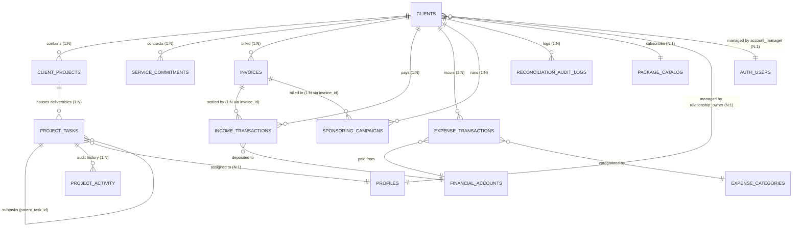

# SADA OS — Client Workspaces & Client 360 Relationship Map

**Document ID:** `SADA-AUDIT-CW-REL-001`  
**Module:** Client Workspaces (`/admin/client-workspaces`) & Client 360 (`/admin/client-workspaces/:id`)  
**Scope:** Relational Schema, Foreign Key Architecture, Multi-Module Touchpoints & Dependency Integrity  
**Audit Date:** October 14, 2026  
**Status:** **PHASE 0 RELATIONSHIP MAP ESTABLISHED**  

---

## 1. Entity-Relationship Architecture

---

## 2. Foreign-Key Dependency & Constraint Matrix

| Source Table & Column | Referenced Table & Column | Constraint Name | On Delete Behavior | Cross-Module Significance |
| :--- | :--- | :--- | :--- | :--- |
| `client_projects.client_id` | `clients.id` | `client_projects_client_id_fkey` | `RESTRICT / NO ACTION` | Prevents deleting a client with active workspace containers. |
| `service_commitments.client_id` | `clients.id` | `service_commitments_client_id_fkey` | `CASCADE` | Recurring commitment rules are tied to the client lifecycle. |
| `project_tasks.project_id` | `client_projects.id` | `project_tasks_project_id_fkey` | `CASCADE` | Deliverables belong directly to the workspace container. |
| `project_tasks.client_id` | `clients.id` | `project_tasks_client_id_fkey` | `SET NULL / RESTRICT` | Direct denormalized lookup for fast multi-tenant filtering. |
| `project_tasks.parent_task_id` | `project_tasks.id` | `project_tasks_parent_task_id_fkey` | `CASCADE` | Hierarchical subtask stages (Scenario $\rightarrow$ Shooting $\rightarrow$ Editing $\rightarrow$ Publishing). |
| `invoices.client_id` | `clients.id` | `invoices_client_id_fkey` | `RESTRICT` | Financial accounting rule: Invoices cannot be orphaned. |
| `income_transactions.client_id` | `clients.id` | `income_transactions_client_id_fkey` | `RESTRICT` | Financial cash ledger rule: Inflows must remain auditable. |
| `income_transactions.invoice_id`| `invoices.id` | `income_transactions_invoice_id_fkey`| `SET NULL` | Links invoice settlement to cash inflow; prevents double-counting. |
| `expense_transactions.client_id`| `clients.id` | `expense_transactions_client_id_fkey`| `SET NULL` | Attributes operational costs to specific clients for margin analysis. |
| `sponsoring_campaigns.client_id`| `clients.id` | `sponsoring_campaigns_client_id_fkey`| `RESTRICT` | Sponsoring ad campaigns cannot exist without client commercial agreement. |
| `clients.package_id` | `package_catalog.id` | `clients_package_id_fkey` | `SET NULL` | Links client to canonical package definition. |

---

## 3. Cross-Module Synchronization & Downstream Dependencies

A mutation inside Client 360 propagates immediately across multiple SADA OS modules:

1. **Package Quota Reconciliation $\rightarrow$ My Work & Calendar:**
   - When a client package quota is updated in `Client 360`, `reconcileClientPackageWork()` evaluates unstarted tasks for the selected period (`yyyy-MM`).
   - If quotas increase, new canonical tasks are inserted into `public.project_tasks`.
   - These tasks instantly populate the worker's **My Work** queue and the agency **Calendar**.
   - If quotas decrease, only unstarted tasks (`status = 'todo'`) are pruned; completed deliverables (`status = 'done'`) remain permanently preserved.
2. **Task Transitions $\rightarrow$ Client 360 Delivery Progress:**
   - When a specialist completes a stage or task in **My Work** or **Calendar**, `computeMonthlyProgress()` recalculates the client's live delivery meter (`completed / quota * 100`).
3. **Invoice Issuance $\rightarrow$ Financial OS & Executive Command Center:**
   - Generating an invoice in Client 360 inserts a row in `public.invoices`.
   - The invoice increases the client's `totalInvoiced` and `totalOutstanding`.
   - The Executive Command Center (`/admin/analytics`) and Financial OS (`/admin/finance`) immediately update outstanding receivables and invoice aging.
4. **Recording Payment $\rightarrow$ Treasury & Cash Reserves:**
   - Settling an invoice via `RecordInvoicePaymentModal` updates `invoices.paid_amount` and inserts an `income_transactions` record.
   - The associated bank account (`financial_accounts.current_balance`) increments by the settled amount.
   - Both Client 360 and Financial OS reflect the new cash collection.
