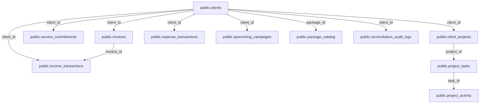

# SADA OS — Client Workspaces & Client 360 Single Source of Truth (SSOT) Map

**Document ID:** `SADA-AUDIT-CW-SSOT-001`  
**Module:** Client Workspaces (`/admin/client-workspaces`) & Client 360 (`/admin/client-workspaces/:id`)  
**Standard:** Zero Duplicate Data Sources · Authoritative Service Paths · Immutable Audit History  
**Audit Date:** October 14, 2026  
**Status:** **PHASE 1 AUTHORITATIVE SSOT REGISTRY**  

---

## 1. Core Entity SSOT Architecture

Every displayed metric, form field, and operational action in Client Workspaces must map directly to its single authoritative source in PostgreSQL. Competing tables, in-memory caches, and fallback constants are strictly prohibited.

---

## 2. Comprehensive Field-by-Field SSOT Mapping

### 1. Client Identity & Contact Data

| Field / Dimension | Authoritative Database Table & Column | Primary / Foreign Key | Canonical Read Query / Service | Authorized Write Mutation Path | RLS & Security Model | Dependent Views & Calculations |
| :--- | :--- | :--- | :--- | :--- | :--- | :--- |
| **Client Name** | `public.clients.name` | PK: `id` (UUID) | `(supabase).from("clients").select("*")` | `(supabase).from("clients").update({ name }).eq("id", id)` | Read: Authenticated. Write: Admin/SuperAdmin (`canEditClient`). | Client Directory, Executive Header, Invoice headers, Workspace deck. |
| **Contact Name** | `public.clients.contact_name` | — | `clients.select("*")` | `clients.update({ contact_name })` | Same as above. | Direct contact modal, WhatsApp/Email deep links. |
| **Email Address** | `public.clients.email` | — | `clients.select("*")` | `clients.update({ email: normalizeEmail(email) })` | Same as above. | Invoice delivery, contact dispatch. |
| **Phone Number** | `public.clients.phone` | — | `clients.select("*")` | `clients.update({ phone: normalizePhone(phone) })` | Same as above. | WhatsApp click-to-chat, phone call actions. |
| **Industry & Web** | `public.clients.industry`, `public.clients.website` | — | `clients.select("*")` | `clients.update({ industry, website })` | Same as above. | Client Directory filters, portfolio categorization. |
| **Status** | `public.clients.status` | Enum: `active`, `inactive`, `prospect`, `archived` | `clients.select("*")` | `clients.update({ status })` | Restricted to Admin/SuperAdmin. | Directory tabs, Active Deliverables count, Work recurrence eligibility. |
| **Engagement Type** | `public.clients.client_type` | Enum: `monthly`, `one_off` | `clients.select("*")` | `clients.update({ client_type })` | Restricted to Admin/SuperAdmin. | Switches UI between Monthly Quotas vs One-Off Scope delivery. |

---

### 2. Commercial & Commercial Package Definition

| Field / Dimension | Authoritative Database Table & Column | Primary / Foreign Key | Canonical Read Query / Service | Authorized Write Mutation Path | Invariant & SSOT Rules |
| :--- | :--- | :--- | :--- | :--- | :--- |
| **Package Selection** | `public.clients.package_id` | FK: `package_id $\rightarrow$ package_catalog(id)` | `resolveAuthoritativePackageConfig()` in `package-reconciliation-service.ts` | `reconcileClientPackageWork()` | `public.package_catalog` is the SOLE canonical catalog. Legacy `public.packages` is deprecated. |
| **Contract Monthly Price** | `public.clients.monthly_package_price` | `NUMERIC(12, 3)` | Read from client row (`monthly_package_price ?? default_service_fee`) | `clients.update({ monthly_package_price })` | **SSOT Invariant:** Client contract rate is independent of master catalog baseline price. Never fallback to `|| 1500`. |
| **Default Sponsoring Budget** | `public.clients.default_sponsoring_budget` | `NUMERIC(12, 3)` | Read from client row (`default_sponsoring_budget`) | `clients.update({ default_sponsoring_budget })` | **SSOT Invariant:** Sponsoring budget is a commercial commitment, NOT an expense until spent. Never fallback to `|| 500`. |
| **Service Quotas (Reels, Posts, Stories)** | `public.clients.package_config` | JSONB: `{ monthly_reels, monthly_posts, monthly_stories, other_services }` | `resolveAuthoritativePackageConfig()` | `clients.update({ package_config })` $\rightarrow$ triggers `reconcileClientPackageWork()` | Reconciled against `public.project_tasks` for the current billing period. |

---

### 3. Operational Workspaces & Project Tasks

| Field / Dimension | Authoritative Database Table & Column | Primary / Foreign Key | Canonical Read Query / Service | Authorized Write Mutation Path | Invariant & SSOT Rules |
| :--- | :--- | :--- | :--- | :--- | :--- |
| **Workspace Container** | `public.client_projects` | PK: `id`, FK: `client_id $\rightarrow$ clients(id)` | `(supabase).from("client_projects").select("*").eq("client_id", id)` | Auto-created on client onboarding via `client-service.ts` | Single operational container per client workspace. |
| **Project Tasks & Stages** | `public.project_tasks` | PK: `id`, FK: `project_id $\rightarrow$ client_projects(id)`, `client_id $\rightarrow$ clients(id)` | `(supabase).from("project_tasks").select("*").eq("client_id", id)` | Canonical `TaskModal.tsx` & `task-execution-service.ts` | Single authoritative source for all deliverables across Calendar, My Work, and Client 360. |
| **Service Commitments** | `public.service_commitments` | PK: `id`, FK: `client_id $\rightarrow$ clients(id)` | `fetchClientCommitments()` in `recurring-scheduling-service.ts` | `saveServiceCommitment()`, `deleteServiceCommitment()` | Manages recurring service quotas independently of one-off tasks. |
| **Deliverable Progress** | Computed Projection | — | `computeMonthlyProgress(tasks, packageConfig)` | Derived in memory from `project_tasks.status = 'done'` | Calculated as `(completed_tasks / total_quota) * 100`. |

---

### 4. Financial OS Integration (Invoices, Income, Expenses, Ads)

| Field / Dimension | Authoritative Database Table & Column | Primary / Foreign Key | Canonical Read Query / Service | Authorized Write Mutation Path | Double-Counting & Reconciliation Invariants |
| :--- | :--- | :--- | :--- | :--- | :--- |
| **Client Invoices** | `public.invoices` | PK: `id`, FK: `client_id $\rightarrow$ clients(id)` | `(supabase).from("invoices").select("*").eq("client_id", id)` | `CreateInvoiceModal.tsx` $\rightarrow$ `finance-service.ts` | Unpaid invoices represent receivables, NOT collected cash. |
| **Collected Revenue (Cash Inflows)** | `public.income_transactions` | PK: `id`, FK: `client_id $\rightarrow$ clients(id)`, `invoice_id $\rightarrow$ invoices(id)` | `(supabase).from("income_transactions").select("*").eq("client_id", id)` | `RecordIncomeModal.tsx` & `RecordInvoicePaymentModal.tsx` | **Double-Counting Prevention:** Payments linked to an invoice via `invoice_id` settle the invoice; unlinked income represents direct receipts. Formula: `totalCollected = invoicePaidTotal + unlinkedIncomeTotal`. |
| **Operational Expenses (Cost Allocation)** | `public.expense_transactions` | PK: `id`, FK: `client_id $\rightarrow$ clients(id)`, `project_id $\rightarrow$ client_projects(id)` | `(supabase).from("expense_transactions").select("*").eq("client_id", id)` | `RecordExpenseModal.tsx` $\rightarrow$ `finance-service.ts` | Direct costs attributed to this specific client. Shared agency overhead is NOT allocated to individual clients. |
| **Sponsoring Campaigns** | `public.sponsoring_campaigns` | PK: `id`, FK: `client_id $\rightarrow$ clients(id)` | `(supabase).from("sponsoring_campaigns").select("*").eq("client_id", id)` | `CreateSponsoringModal.tsx` $\rightarrow$ `finance-service.ts` | Authoritative columns: `budget_tnd`, `purchase_cost_tnd` (ad spend cost), `client_charge_tnd` (billed fee), `margin_tnd` (agency margin). |
| **Outstanding Receivables** | Computed Projection | — | `Math.max(0, totalInvoiced - invoicePaidTotal)` | Derived from `public.invoices` | Aging and remaining balance derived from actual settlements. |
| **Client Profit Margin** | Computed Projection | — | `(netProfit / totalTopline) * 100` | Derived in memory | Net profit = `monthlyRevenue + sponsoringMargin - (clientExpenses > 0 ? clientExpenses : estimatedDirectCost) - estimatedCommission`. Default is 0% when topline is 0. |

---

### 5. Historical Audit & Activity Trail

| Audit Entity | Authoritative Database Table | Primary Key | Key Foreign Keys | Purpose & Immutability Rules |
| :--- | :--- | :--- | :--- | :--- |
| **Package Reconciliation Audit Logs** | `public.reconciliation_audit_logs` | `id` (UUID) | `client_id $\rightarrow$ clients(id)`, `task_id $\rightarrow$ project_tasks(id)` | Append-only audit of every quota modification, task generation, task pruning, and reschedule event. |
| **Task Activity Audit Logs** | `public.project_activity` | `id` (UUID) | `task_id $\rightarrow$ project_tasks(id)`, `actor_id $\rightarrow$ auth.users(id)` | Append-only log of task assignments, status changes, delivery submissions, and handoffs. |
| **System Security Audit Logs** | `public.system_audit_logs` | `id` (UUID) | `actor_id $\rightarrow$ auth.users(id)` | Immutable security audit log protected by PostgreSQL trigger `trg_prevent_update_account_audit`. |

---

### 6. Client Lifecycle Operations (Permanent Deletion & Reversible Archiving)

| Operation | Canonical RPC / Mutation Path | Security & Authorization | Safeguards & Invariants | Execution Order & Effects |
| :--- | :--- | :--- | :--- | :--- |
| **Pre-Flight Lifecycle Audit** | `public.admin_analyze_client_lifecycle(_client_id)` | Authenticated SADA User (`has_sada_access`) | Non-mutating read query | Computes operational vs financial dependencies. Sets `can_delete_permanently: false` if client has issued invoices or approved commissions. |
| **Permanent Deletion** | `public.admin_delete_client_permanently(_client_id)` | Super Admin Exclusive (`is_super_admin`) | **Strict Financial Safeguard:** Blocked with `CANNOT_DELETE_FINANCIAL_RECORDS` if `invoices > 0` or approved/paid sales commissions exist. | 1. Nullifies non-blocking financial references (`income_transactions`, `expense_transactions`, `deals`, `work_sessions`, `contact_submissions`, `testimonials`). 2. Purges operational dependencies (`project_tasks`, `client_deliverables`, `service_commitments`, `production_bookings`, `sponsoring_campaigns`, `client_communication_logs`, `client_projects`). 3. Deletes `public.clients` row. 4. Writes audit entry `CLIENT_DELETED` into `public.system_audit_logs`. |
| **Reversible Archiving** | `public.admin_archive_client(_client_id)` | Super Admin or Admin with `clients` module access | Non-destructive, 100% reversible | 1. Updates client `status = 'archived'`. 2. Sets active `service_commitments.status = 'paused'` with `paused_at = now()`. 3. Pauses uncompleted tasks while preserving original state in `notes` with `[ARCHIVED_PREV_STATUS:<status>]`. Completed historical work (`done`, `approved`, etc.) remains untouched. 4. Excludes client from active lists, calendar queries, and team workload. 5. Writes audit entry `CLIENT_ARCHIVED`. |
| **Client Restoration** | `public.admin_restore_client(_client_id)` | Super Admin or Admin with `clients` module access | Idempotent, duplicate-safe | 1. Updates client `status = 'active'`. 2. Reactivates paused commitments with `reactivated_at = now()`. 3. Restores paused tasks to their exact preserved statuses from `notes` tag and strips tag. 4. Idempotently triggers `reconcileClientPackageWork` for monthly retainers. 5. Writes audit entry `CLIENT_RESTORED`. |

