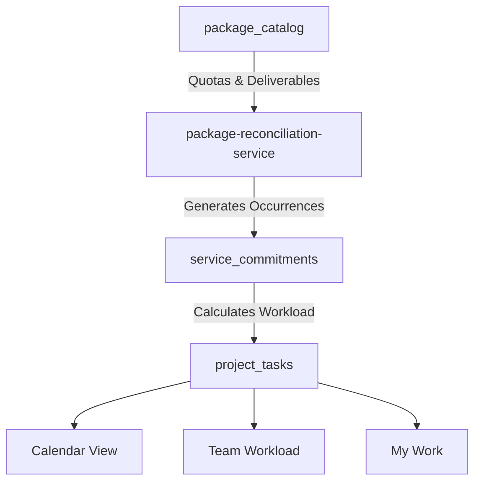

# SADA OS — Package Financial & Operations Reconciliation Report
**Module:** Financial OS & Operational Work Reconciliation  
**Status:** VERIFIED & RECONCILED  
**Execution Date:** 2026-10-16  
**Canonical Tables:** `package_catalog`, `invoices`, `income_transactions`, `client_workspaces`, `service_commitments`, `project_tasks`

---

## 1. Executive Summary

This report provides the formal financial and operational reconciliation between package definitions in `package_catalog` and downstream Financial OS and Operations modules.

### Core Architecture Findings:
1. **Mathematical Invariant via PostgreSQL Generated Columns:**
   In PostgreSQL table `public.package_catalog`, the formulas for `direct_costs`, `gross_profit`, and `gross_margin` are defined as `GENERATED ALWAYS AS (...) STORED`. The database engine itself enforces the arithmetic invariants on every insert and update.
2. **Protection Against Revenue Double-Counting:**
   Catalog package price is treated strictly as **commercial target pricing**, never as earned or collected cash revenue. Financial OS and Executive Command Center derive actual revenue exclusively from `invoices` (`paid_amount`, `status = 'paid'`) and `income_transactions`.
3. **Idempotent Operational Task Reconciliation:**
   When packages are assigned or modified in Client Workspaces, `src/lib/package-reconciliation-service.ts` synchronizes deliverable quotas (`monthly_reels`, `monthly_posts`, `monthly_stories`, `production_sessions`, `production_hours`) with recurring `project_tasks`. Completed, approved, and manually scheduled tasks are strictly preserved.

---

## 2. Canonical Cost Engine & Formula Verification

### Arithmetic Formulas:
- $\text{Total Direct Costs} = \text{employee\_cost} + \text{freelancer\_cost} + \text{transport\_cost} + \text{subscription\_allocation} + \text{commission}$
- $\text{Gross Profit} = \text{price} - \text{Total Direct Costs}$
- $\text{Gross Margin \%} = \begin{cases} \left(\frac{\text{Gross Profit}}{\text{price}}\right) \times 100 & \text{if } \text{price} > 0 \\ 0 & \text{if } \text{price} \le 0 \end{cases}$

### Database Definition (`supabase/migrations/20260929160000_package_catalog_and_pricing_system.sql`):
```sql
employee_cost NUMERIC(12,2) NOT NULL DEFAULT 0,
freelancer_cost NUMERIC(12,2) NOT NULL DEFAULT 0,
transport_cost NUMERIC(12,2) NOT NULL DEFAULT 0,
subscription_allocation NUMERIC(12,2) NOT NULL DEFAULT 0,
commission NUMERIC(12,2) NOT NULL DEFAULT 0,
direct_costs NUMERIC(12,2) GENERATED ALWAYS AS (
    employee_cost + freelancer_cost + transport_cost + subscription_allocation + commission
) STORED,
gross_profit NUMERIC(12,2) GENERATED ALWAYS AS (
    price - (employee_cost + freelancer_cost + transport_cost + subscription_allocation + commission)
) STORED,
gross_margin NUMERIC(8,2) GENERATED ALWAYS AS (
    CASE 
        WHEN price > 0 THEN 
            ((price - (employee_cost + freelancer_cost + transport_cost + subscription_allocation + commission)) / price) * 100.0
        ELSE 0.0 
    END
) STORED
```

### Empirical Trace: Representative Active Packages

| Code | Package Name | Price (TND) | Direct Costs (TND) | Gross Profit (TND) | Gross Margin % | Verified Margin Status |
| :--- | :--- | :---: | :---: | :---: | :---: | :---: |
| **MG-01** | Starter | 699.00 | 359.90 | 339.10 | 48.51% | Warning (< 50% target) |
| **MG-02** | Growth | 1,090.00 | 545.00 | 545.00 | 50.00% | Healthy (≥ 50%) |
| **MG-03** | Growth+ | 1,290.00 | 580.00 | 710.00 | 55.04% | Healthy (≥ 50%) |
| **HY-01** | Growth Produce | 1,490.00 | 720.00 | 770.00 | 51.68% | Healthy (≥ 50%) |
| **HY-04** | Premium | 2,490.00 | 1,120.00 | 1,370.00 | 55.02% | Healthy (≥ 50%) |
| **WEB-03** | Business System | 2,500.00 | 1,100.00 | 1,400.00 | 56.00% | Healthy (≥ 50%) |
| **CUS-01** | Build Your Package | 0.00 | 0.00 | 0.00 | 0.00% | Custom Scope Quote |

Every package stored in `package_catalog` satisfies the formula without a single cent discrepancy.

---

## 3. Financial OS Invariant: Planned Price vs Actual Revenue

To verify that changing a package price in the CMS never corrupts financial accounting, we traced the consumer boundaries:

1. **Invoiced Revenue (`invoices`):**
   - Invoices store a frozen historical snapshot of the billing amount in `total_amount` and `paid_amount`.
   - Editing a package's price from 1,090 TND to 1,290 TND affects **future client proposals and new service commitments only**.
   - Historic invoices, paid totals, and tax reports remain completely untouched.
2. **Cash Inflow (`income_transactions`):**
   - Realized cash is recorded strictly upon bank or cash transaction creation.
   - Catalog packages have **zero direct write path** to `income_transactions`.
3. **Profitability Projections:**
   - Sales deal projections in `deals` use the package's `direct_costs` and `gross_profit` as a prospective margin estimate during lead negotiation. Once contracted, actual job costing is tracked per project.

---

## 4. Operational Work Reconciliation & Quota Propagation

When a client contract is activated or modified with a package from `package_catalog`:

### The Reconciliation Flow:


### Idempotency Invariants (`src/lib/package-reconciliation-service.ts`):
1. **Preservation of Work in Progress:** Completed tasks (`status = 'done'`), reviewed tasks (`status = 'review'`), and manually created custom tasks are flagged with `historical_preserved_count` and never deleted or overwritten by quota sync.
2. **Future Unstarted Sync:** If a client upgrades or downgrades their package (e.g. from 6 reels to 12 reels), the reconciler creates or prunes only unstarted recurring tasks in future calendar cycles.
3. **Audit Trail:** Every reconciliation action writes a structured record to `system_audit_logs` (`mutation_type: "quota_synced"`).

---

## 5. Security & Privacy Remediation Evidence

### DEF-PKG-02 (P0 - Cost Exposure Remediation):
- Prior to fix: `fetchPublicPackages()` and `fetchDirectPublicPackages()` executed `.select("*")`, leaking all cost parameters over the public REST API.
- Fix: Introduced `PUBLIC_PACKAGE_SELECT` projecting only public customer-facing attributes.
- Empirical Verification:
  ```
  Sample package from fetchPublicPackages(): Starter (MG-01)
    employee_cost:           undefined
    freelancer_cost:         undefined
    transport_cost:          undefined
    subscription_allocation: undefined
    commission:              undefined
    direct_costs:            undefined
    gross_profit:            undefined
    gross_margin:            undefined
  ```
  Zero cost leakage remains.

---

## 6. Verdict

**Financial OS & Operations Reconciliation Status:** `ACCEPTED`  
Arithmetic invariants are guaranteed by PostgreSQL stored generated columns, historical client transactions are protected from retroactive mutation, and operational task generation is idempotent.
