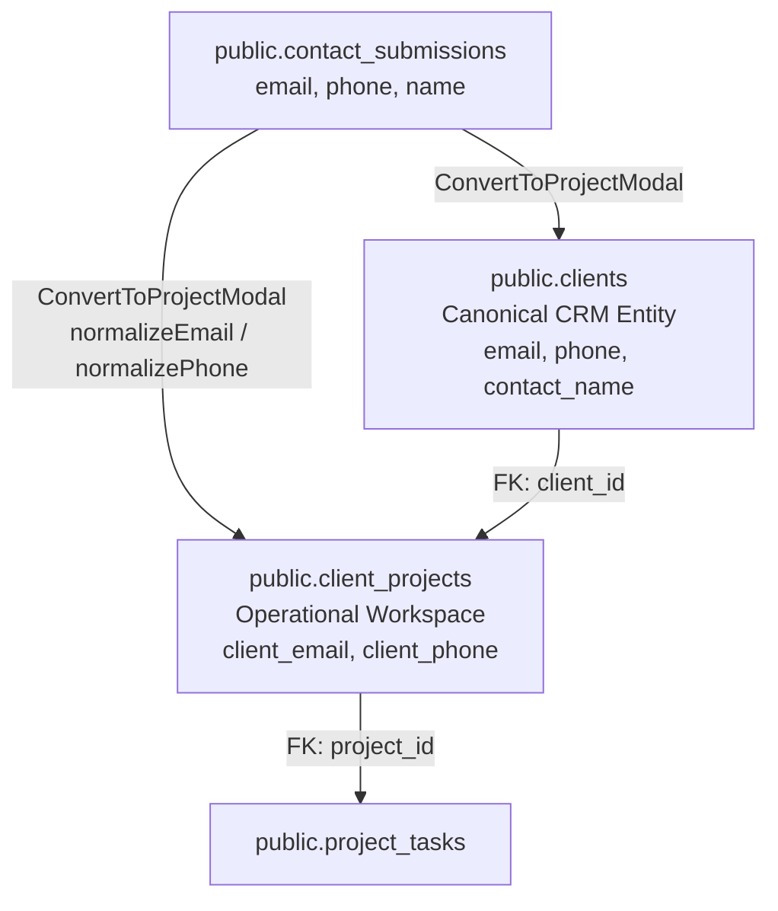

# SADA OS — Phase 3: Structured Client Contact Implementation Plan

**Standard:** Zero Unstructured Contact Concatenation · Canonical CRM SSOT · Idempotent Forward-Only Migration  
**Date:** October 17, 2026  
**Status:** **APPROVED FOR IMPLEMENTATION (PHASE 3 ONLY)**  

---

## 1. Executive Summary & Objective

In SADA OS, client inquiries (`public.contact_submissions`) capture inbound prospect contacts (`email`, `phone`, `name`). When converting an inquiry into an active project workspace via `ConvertToProjectModal.tsx`, the system previously lacked structured columns for contact information on `public.client_projects`.

As a legacy workaround, contact information was concatenated into the `description` string:
```ts
const contactBlock = [
  inquiry.email ? `Email: ${inquiry.email}` : null,
  inquiry.phone ? `Phone: ${inquiry.phone}` : null,
  d.preferred_contact ? `Preferred Channel: ${d.preferred_contact}` : null,
].filter(Boolean).join(" · ");

const initialDescription = [..., contactBlock ? `\n\n[CLIENT CONTACT: ${contactBlock}]` : ""].join("");
```

This caused:
1. Fragile unstructured text parsing for any downstream service or UI attempting to reach the client.
2. Inability to query, filter, or index projects by client contact details.
3. Inconsistent contact mapping between `contact_submissions`, `clients`, and `client_projects`.

### Phase 3 Scope & Invariants
- Introduce structured `client_email` and `client_phone` columns directly to `public.client_projects`.
- Preserve `public.clients` as the canonical CRM entity master (`clients.email`, `clients.phone`).
- Update `ConvertToProjectModal.tsx` to directly write structured, normalized `client_email` and `client_phone` to `client_projects` while continuing to maintain backward compatibility.
- Update `admin.client-workspaces.index.tsx` (workspace creation for monthly and one-off) to populate structured `client_email` and `client_phone`.
- Expose structured contact fields in project workspace views with standard SADA Design System components and copy/call affordances.
- Apply non-destructive idempotent database migration with automated backfill from `public.clients` and `public.contact_submissions`.
- Maintain strict database isolation (local PostgreSQL 16 on `127.0.0.1:5432/sada_local_test`). Zero mutations against remote production.

---

## 2. Architectural Single Source of Truth (SSOT)



### Responsibility Matrix:
- **`public.clients`**: Master CRM record for commercial relationship, billing, contracts, and company identity.
- **`public.contact_submissions`**: Immutable audit log of inbound prospect inquiries.
- **`public.client_projects`**: Operational workspace container. Houses project deliverables and holds project-level contact coordinates (`client_email`, `client_phone`).

---

## 3. Database Schema Migration Plan

Migration file: `supabase/migrations/20261017190000_add_client_contact_to_client_projects.sql`

```sql
-- 1. Add structured contact columns to client_projects
ALTER TABLE public.client_projects
  ADD COLUMN IF NOT EXISTS client_email TEXT,
  ADD COLUMN IF NOT EXISTS client_phone TEXT;

-- 2. Performance & search indexes
CREATE INDEX IF NOT EXISTS idx_client_projects_client_email ON public.client_projects(client_email);
CREATE INDEX IF NOT EXISTS idx_client_projects_client_phone ON public.client_projects(client_phone);

-- 3. Idempotent Backfill:
-- Strategy A: Backfill from canonical clients table
UPDATE public.client_projects cp
SET 
  client_email = COALESCE(cp.client_email, c.email),
  client_phone = COALESCE(cp.client_phone, c.phone)
FROM public.clients c
WHERE cp.client_id = c.id
  AND (cp.client_email IS NULL OR cp.client_phone IS NULL)
  AND (c.email IS NOT NULL OR c.phone IS NOT NULL);

-- Strategy B: Backfill remaining from linked contact_submissions
UPDATE public.client_projects cp
SET 
  client_email = COALESCE(cp.client_email, cs.email),
  client_phone = COALESCE(cp.client_phone, cs.phone)
FROM public.contact_submissions cs
WHERE cp.contact_submission_id = cs.id
  AND (cp.client_email IS NULL OR cp.client_phone IS NULL)
  AND (cs.email IS NOT NULL OR cs.phone IS NOT NULL);
```

---

## 4. Frontend & Service Layer Updates

1. **`src/integrations/supabase/types.ts`**:
   - Add `client_email: string | null` and `client_phone: string | null` to `client_projects` Row, Insert, and Update definitions.

2. **`src/components/admin/ConvertToProjectModal.tsx`**:
   - In `save()`: Pass `client_email: normalizeEmail(inquiry.email)` and `client_phone: normalizePhone(inquiry.phone)` in `client_projects` insert body.
   - Retain optional clean description formatting without messy raw contact blocks.

3. **`src/routes/admin.client-workspaces.index.tsx`**:
   - In monthly client workspace creation: Pass `client_email: normalizeEmail(newEmail)` and `client_phone: normalizePhone(newPhone)` to `client_projects` insert.
   - In one-off client workspace creation: Pass `client_email: normalizeEmail(newEmail)` and `client_phone: normalizePhone(newPhone)` to `client_projects` insert.

4. **`src/routes/admin.client-workspaces.$id.tsx`**:
   - Surface structured project contact coordinates where relevant or ensure synchronization with the client entity.

---

## 5. Test & Certification Plan

Create `scripts/certify-phase3-structured-client-contact.ts`:
1. **Migration Verification**: Assert columns `client_email` and `client_phone` exist with indexes `idx_client_projects_client_email` and `idx_client_projects_client_phone`.
2. **Direct Project Creation Test**: Insert project with structured `client_email` and `client_phone`; verify retrieval.
3. **Inquiry-to-Project Transition Test**: Create synthetic `contact_submissions` row, simulate conversion into `clients` + `client_projects`, verify contact fields mapped and normalized.
4. **Validation & Normalization Test**: Malformed emails and phones normalized or handled safely without crashing.
5. **Backfill Verification**: Insert legacy project with NULL contact fields linked to client with contact info; verify migration backfill populates them.
6. **Authorization & RLS Verification**: Verify that anonymous users cannot read `client_email` / `client_phone` from `client_projects`, while authorized workers and admins can.
7. **Regression Suite**: Re-run existing Phase 1A.1 and Phase 2 suites to guarantee 0 regressions.
