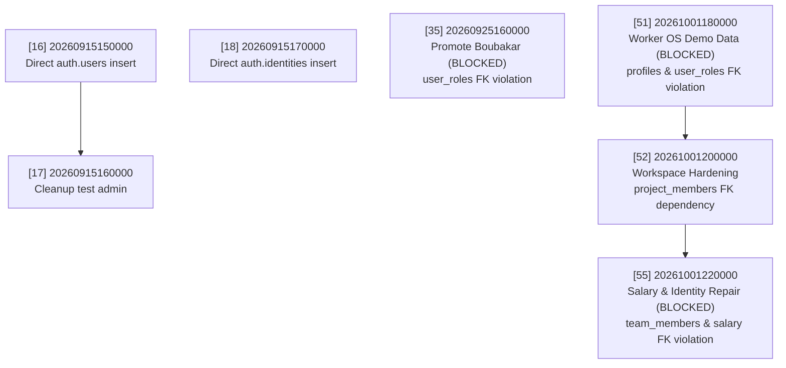

# SADA OS — Staging Migration Risk Register

**Document ID:** `SADA-STAGING-RISK-001`  
**Review Standard:** Zero-Trust Migration Safety · Foreign-Key Integrity · Auth Schema Isolation  
**Review Date:** October 14, 2026  
**Auditor:** Database Architect & Systems Reliability Engineer  
**Execution Status:** **READ-ONLY DISCOVERY COMPLETE — NO MUTATIONS EXECUTED**  

---

## 1. Executive Summary of Risk Classifications

A comprehensive SQL-level audit of all **96 migration files** in `supabase/migrations/` was conducted to determine whether a brand-new, clean Supabase staging project can safely receive the repository migrations sequentially.

| Classification | Count | Definition |
| :--- | :---: | :--- |
| **`SAFE_FOR_FRESH_STAGING`** | **85** | Pure declarative DDL, idempotent routines, safe RLS policies, or self-contained seeds that run cleanly without external dependencies. |
| **`REQUIRES_REVIEW`** | **5** | Migrations modifying storage buckets, global auth triggers, or performing non-blocking user cleanups. Safe if prerequisites are met. |
| **`REQUIRES_STAGING_ADAPTATION`** | **3** | Migrations executing direct DML on internal Supabase schemas (`auth.users`, `auth.identities`) or referencing dependent profiles. |
| **`BLOCKED`** | **3** | **Critical Blockers**: Migrations that will fail with fatal foreign-key constraint violations on a clean staging database because they assume pre-existing production records. |
| **Total Migrations Audited** | **96** | **100% of repository migrations inspected.** |

---

## 2. Critical & High Risk Findings Register

The following register details every migration classified as `BLOCKED`, `REQUIRES_STAGING_ADAPTATION`, or `REQUIRES_REVIEW`.



### Risk Item 1: `20260925160000_promote_boubakar_to_super_admin.sql`
- **Migration Index:** 35 / 96
- **Classification:** **`BLOCKED`**
- **Risk Level:** **CRITICAL**
- **Evidence:**
  ```sql
  -- L12-19
  IF EXISTS (SELECT 1 FROM public.user_roles WHERE user_id = _boubakar_uid) THEN
    UPDATE public.user_roles SET role = 'super_admin' WHERE user_id = _boubakar_uid;
  ELSE
    INSERT INTO public.user_roles (user_id, role)
    VALUES ('f4184256-97c4-4f81-9346-176ec5dfb43a', 'super_admin');
  END IF;
  ```
- **Likely Impact:** Fatal Migration Abortion (`supabase db push` halts at migration 35).
  `public.user_roles.user_id` has a foreign key constraint: `REFERENCES auth.users(id) ON DELETE CASCADE`. Because a clean staging database has an empty `auth.users` table, the `ELSE` branch executes and throws:
  `ERROR: insert or update on table "user_roles" violates foreign key constraint "user_roles_user_id_fkey"`.
- **Recommended Action:** Pre-seed `auth.users` with Boubakar's UUID prior to migration rollout, or adapt migration to guard the insert with `IF EXISTS (SELECT 1 FROM auth.users WHERE id = _boubakar_uid)`.

---

### Risk Item 2: `20261001180000_worker_os_sales_commissions_and_workspace.sql`
- **Migration Index:** 51 / 96
- **Classification:** **`BLOCKED`**
- **Risk Level:** **CRITICAL**
- **Evidence:**
  ```sql
  -- L129, L138, L142
  v_worker_uid UUID := '77f7a3d3-82c1-4744-8f01-0a1fd5f44bba';
  v_worker_tm_id UUID := '9c0937f7-4617-4803-b718-a3d9a5175dd9';
  ...
  INSERT INTO public.profiles (id, display_name, status)
  VALUES (v_worker_uid, 'QA Worker Lead', 'active')
  ON CONFLICT (id) DO UPDATE SET display_name = 'QA Worker Lead', status = 'active';

  INSERT INTO public.user_roles (user_id, role)
  VALUES (v_worker_uid, 'worker'::app_role)
  ON CONFLICT (user_id, role) DO NOTHING;
  ```
- **Likely Impact:** Fatal Migration Abortion (`supabase db push` halts at migration 51).
  Both `public.profiles.id` and `public.user_roles.user_id` strictly reference `auth.users(id)`. Because `77f7a3d3-82c1-4744-8f01-0a1fd5f44bba` exists only in production GoTrue auth, PostgreSQL aborts with `profiles_id_fkey` violation.
- **Recommended Action:** Provision the canonical QA Worker account in `auth.users` during staging preflight, or guard the profile and user_roles inserts.

---

### Risk Item 3: `20261001220000_worker_role_auth_identity_and_rls_repair.sql`
- **Migration Index:** 55 / 96
- **Classification:** **`BLOCKED`**
- **Risk Level:** **CRITICAL**
- **Evidence:**
  ```sql
  -- L28-53
  INSERT INTO public.salary_records (
    team_member_id, base_amount, currency, salary_type, payment_frequency, ...
  )
  SELECT
    '9c0937f7-4617-4803-b718-a3d9a5175dd9',
    1400.000, 'TND', 'monthly', 'monthly', ...
  WHERE NOT EXISTS (
    SELECT 1 FROM public.salary_records WHERE team_member_id = '9c0937f7-4617-4803-b718-a3d9a5175dd9'
  );
  ```
- **Likely Impact:** Fatal Migration Abortion (`supabase db push` halts at migration 55).
  `public.salary_records.team_member_id` strictly references `public.team_members(id)`. The migration assumes `9c0937f7-4617-4803-b718-a3d9a5175dd9` already exists. On a fresh database, `team_members` was never seeded with this hardcoded UUID (migration 51 only ran an `UPDATE` on it). The `INSERT` throws `salary_records_team_member_id_fkey` violation.
- **Recommended Action:** Ensure canonical team member record `9c0937f7-4617-4803-b718-a3d9a5175dd9` is pre-seeded before running migration 55, or guard the insert with `JOIN public.team_members`.

---

### Risk Item 4: `20260915150000_create_test_admin_user.sql`
- **Migration Index:** 16 / 96
- **Classification:** **`REQUIRES_STAGING_ADAPTATION`**
- **Risk Level:** **HIGH**
- **Evidence:**
  ```sql
  -- L8-24
  INSERT INTO auth.users (
    id, instance_id, aud, role, email, encrypted_password, email_confirmed_at, ...
  ) VALUES (
    '00000000-0000-0000-0000-000000000001',
    '00000000-0000-0000-0000-000000000000',
    'authenticated', 'authenticated', 'admin.security.test@sada.agency', ...
  );
  ```
- **Likely Impact:** Direct insertion into Supabase internal schema `auth.users`. While CLI connections as `postgres` generally allow this, differences in Supabase GoTrue schema versions (e.g., missing columns or instance_id constraints) can cause failures.
- **Recommended Action:** Confirm target staging Supabase instance allows direct `auth.users` writes by the migration runner role. (Note: Migration 17 immediately deletes this user).

---

### Risk Item 5: `20260915170000_confirmed_auth_test_user.sql`
- **Migration Index:** 18 / 96
- **Classification:** **`REQUIRES_STAGING_ADAPTATION`**
- **Risk Level:** **HIGH**
- **Evidence:**
  ```sql
  -- L7-35
  INSERT INTO auth.users (...) VALUES ('11111111-1111-1111-1111-111111111111', ...);
  INSERT INTO auth.identities (...) VALUES ('11111111-1111-1111-1111-111111111111', ...);
  ```
- **Likely Impact:** Direct insertion into both `auth.users` and `auth.identities`. Requires `extensions.crypt` and schema compatibility with `auth.identities`.
- **Recommended Action:** Verify `pgcrypto` extension is installed and active on the staging database.

---

### Risk Item 6: `20261001200000_worker_sales_commissions_and_workspace_hardening.sql`
- **Migration Index:** 52 / 96
- **Classification:** **`REQUIRES_STAGING_ADAPTATION`**
- **Risk Level:** **HIGH**
- **Evidence:**
  ```sql
  -- L209-226
  INSERT INTO public.project_members (project_id, profile_id, team_member_id, role)
  VALUES (v_proj_jannat, '77f7a3d3-82c1-4744-8f01-0a1fd5f44bba', '9c0937f7-4617-4803-b718-a3d9a5175dd9', 'lead');
  ```
- **Likely Impact:** Cascading foreign key failure if migration 51 fails or if worker profile is missing.
- **Recommended Action:** Resolves automatically once Risk Item 2 (`20261001180000`) pre-seeding is in place.

---

### Risk Item 7: `20260915190000_autoconfirm_test_users.sql`
- **Migration Index:** 20 / 96
- **Classification:** **`REQUIRES_REVIEW`**
- **Risk Level:** **MEDIUM**
- **Evidence:**
  ```sql
  -- L10-13
  CREATE TRIGGER on_auth_user_autoconfirm
  BEFORE INSERT ON auth.users
  FOR EACH ROW EXECUTE FUNCTION public.autoconfirm_user();
  ```
- **Likely Impact:** Globally auto-confirms all email signups across the staging project. Desirable for automated staging E2E tests, but diverges from production email verification behavior.
- **Recommended Action:** Document as intentional staging testing behavior.

---

### Risk Item 8: `20260508145232` & `20260915120000` (Storage Buckets)
- **Migration Indexes:** 1 / 96, 13 / 96
- **Classification:** **`REQUIRES_REVIEW`**
- **Risk Level:** **MEDIUM**
- **Evidence:**
  ```sql
  INSERT INTO storage.buckets (id, name, public) VALUES ('media', 'media', true) ON CONFLICT (id) DO NOTHING;
  ```
- **Likely Impact:** Relies on the `storage` schema being provisioned by the Supabase platform.
- **Recommended Action:** Clean Supabase cloud projects provision `storage` by default. Guarded by `ON CONFLICT (id) DO NOTHING`, so safe on fresh instances.

---

### Risk Item 9: `20260915160000` & `20261002130000` (Test Account Cleanup)
- **Migration Indexes:** 17 / 96, 59 / 96
- **Classification:** **`REQUIRES_REVIEW`**
- **Risk Level:** **LOW to MEDIUM**
- **Evidence:**
  ```sql
  DELETE FROM auth.users WHERE id = 'dc9a9cfa-4d9e-4705-9042-1d13ebf4b294';
  ```
- **Likely Impact:** If target records do not exist, `DELETE` statements affect 0 rows and return success. Non-blocking on clean staging.
- **Recommended Action:** Safe to execute sequentially.

---

## 3. Complete 96-Migration Classification Roster

| # | Migration File | Classification | Risk | Primary DDL / DML Scope |
| :-: | :--- | :---: | :---: | :--- |
| **1** | `20260508145232_0ff07d38-46b8-4dd1-8c8a-e8fdbef4b02b.sql` | `REQUIRES_REVIEW` | MEDIUM | Core auth triggers, profiles, user_roles, storage buckets |
| **2** | `20260508151424_f13c0064-60a7-48a7-a466-bfc86b0713f7.sql` | `SAFE_FOR_FRESH_STAGING` | LOW | CMS tables, blog posts, portfolio items |
| **3** | `20260512231409_d4005355-5976-4103-83da-2d7fa09cd478.sql` | `SAFE_FOR_FRESH_STAGING` | LOW | Initial showcase seed (projects, team_members, packages) |
| **4** | `20260606183754_609950ab-3776-45e6-a4f8-ce650a16020e.sql` | `SAFE_FOR_FRESH_STAGING` | LOW | Contact submissions, inquiries |
| **5** | `20260712160521_8318a926-7fce-48a6-946c-80264ddacb40.sql` | `SAFE_FOR_FRESH_STAGING` | LOW | Media library metadata & storage RLS |
| **6** | `20260726120000_c3f0a7f0-0d4e-4bfa-9d3d-9f4b1a8b1a01.sql` | `SAFE_FOR_FRESH_STAGING` | LOW | Site configuration & branding settings |
| **7** | `20260727090000_a5e8c1f2-4b6d-4e2a-9c7f-2d3b6a9e1c04.sql` | `SAFE_FOR_FRESH_STAGING` | LOW | Site settings RLS policies |
| **8** | `20260914150000_client_projects_tasks.sql` | `SAFE_FOR_FRESH_STAGING` | LOW | Client projects, deliverables, tasks schema |
| **9** | `20260914160000_smart_discovery_submissions.sql` | `SAFE_FOR_FRESH_STAGING` | LOW | Discovery form submissions table |
| **10** | `20260914170000_work_os_upgrade.sql` | `SAFE_FOR_FRESH_STAGING` | LOW | Task categories, deadlines, priority indexes |
| **11** | `20260914180000_add_task_assigned_by_and_followup.sql` | `SAFE_FOR_FRESH_STAGING` | LOW | Task assigner FK, followup status fields |
| **12** | `20260914190000_unified_team_members.sql` | `SAFE_FOR_FRESH_STAGING` | LOW | Unified team members schema |
| **13** | `20260915120000_ensure_storage_media_bucket.sql` | `REQUIRES_REVIEW` | MEDIUM | Idempotent media bucket insertion |
| **14** | `20260915130000_team_members_rls_policy.sql` | `SAFE_FOR_FRESH_STAGING` | LOW | Team members RLS policies |
| **15** | `20260915140000_secure_storage_media_bucket.sql` | `SAFE_FOR_FRESH_STAGING` | LOW | Storage bucket upload/read policies |
| **16** | `20260915150000_create_test_admin_user.sql` | `REQUIRES_STAGING_ADAPTATION` | HIGH | Direct insert into `auth.users` |
| **17** | `20260915160000_fix_test_admin_user.sql` | `REQUIRES_REVIEW` | MEDIUM | Cleans up user created in migration 16 |
| **18** | `20260915170000_confirmed_auth_test_user.sql` | `REQUIRES_STAGING_ADAPTATION` | HIGH | Direct insert into `auth.users` & `auth.identities` |
| **19** | `20260915180000_list_auth_users.sql` | `SAFE_FOR_FRESH_STAGING` | LOW | Read-only inspection notice loop |
| **20** | `20260915190000_autoconfirm_test_users.sql` | `REQUIRES_REVIEW` | MEDIUM | `on_auth_user_autoconfirm` trigger on `auth.users` |
| **21** | `20260915200000_ensure_profiles_exist.sql` | `SAFE_FOR_FRESH_STAGING` | LOW | Profile backfill trigger update |
| **22** | `20260915210000_add_client_projects_lead_id.sql` | `SAFE_FOR_FRESH_STAGING` | LOW | Project lead FK addition |
| **23** | `20260916140000_sada_works_rbac.sql` | `SAFE_FOR_FRESH_STAGING` | LOW | RBAC helper functions (`is_admin`, `is_super_admin`) |
| **24** | `20260916150000_grant_function_execute.sql` | `SAFE_FOR_FRESH_STAGING` | LOW | Function execute grants |
| **25** | `20260916160000_fix_rbac_delete_policies.sql` | `SAFE_FOR_FRESH_STAGING` | LOW | Fix task delete policy for super admin |
| **26** | `20260916170000_crm_foundation_clients.sql` | `SAFE_FOR_FRESH_STAGING` | LOW | Defines `public.clients` table and safe seed |
| **27** | `20260917120000_case_studies_cms_upgrade.sql` | `SAFE_FOR_FRESH_STAGING` | LOW | Case study CMS fields & tags |
| **28** | `20260920170000_social_reels_cms.sql` | `SAFE_FOR_FRESH_STAGING` | LOW | Social reels CMS schema |
| **29** | `20260920190000_client_centric_operations.sql` | `SAFE_FOR_FRESH_STAGING` | LOW | Client operations & communication logs |
| **30** | `20260920203000_calendar_execution_and_handoffs.sql` | `SAFE_FOR_FRESH_STAGING` | LOW | Editorial calendar & task activity tracking |
| **31** | `20260921120000_content_cms_upgrade.sql` | `SAFE_FOR_FRESH_STAGING` | LOW | Multi-media content CMS upgrade |
| **32** | `20260924090000_fix_task_completed_at_integrity.sql` | `SAFE_FOR_FRESH_STAGING` | LOW | Task completion timestamp triggers |
| **33** | `20260924103000_multilingual_cms_content.sql` | `SAFE_FOR_FRESH_STAGING` | LOW | Arabic/French multilingual content columns |
| **34** | `20260925143000_financial_command_center.sql` | `SAFE_FOR_FRESH_STAGING` | LOW | Financial accounts, ledger, expense categories |
| **35** | `20260925160000_promote_boubakar_to_super_admin.sql` | `BLOCKED` | CRITICAL | Unguarded insert into `user_roles` (Boubakar UUID) |
| **36** | `20260925180000_super_admin_account_management.sql` | `SAFE_FOR_FRESH_STAGING` | LOW | Account provisioning RPC (`admin_provision_account`) |
| **37** | `20260925183000_admin_provision_account.sql` | `SAFE_FOR_FRESH_STAGING` | LOW | Account provisioning RPC refinements |
| **38** | `20260927230000_sada_financial_operating_system.sql` | `SAFE_FOR_FRESH_STAGING` | LOW | Defines `public.sales_commissions` table |
| **39** | `20260928200000_account_lifecycle_and_crm_integrity.sql` | `SAFE_FOR_FRESH_STAGING` | LOW | Internal operations client & lifecycle RLS |
| **40** | `20260928210000_client_workspace_crm_foundation.sql` | `SAFE_FOR_FRESH_STAGING` | LOW | Client workspaces schema |
| **41** | `20260929120000_sales_pipeline_package_and_production.sql` | `SAFE_FOR_FRESH_STAGING` | LOW | Defines `public.deals` pipeline table |
| **42** | `20260929130000_update_task_completed_at_trigger.sql` | `SAFE_FOR_FRESH_STAGING` | LOW | Task completion triggers |
| **43** | `20260929140000_team_time_cost_and_ledger_integration.sql` | `SAFE_FOR_FRESH_STAGING` | LOW | Work sessions, hourly cost integration |
| **44** | `20260929150000_phase7_and_phase8_notifications_and_audit.sql` | `SAFE_FOR_FRESH_STAGING` | LOW | Notifications and audit logs schema |
| **45** | `20260929160000_package_catalog_and_pricing_system.sql` | `SAFE_FOR_FRESH_STAGING` | LOW | Package catalog tables and seed data |
| **46** | `20261001090000_enable_realtime_and_notification_policies.sql` | `SAFE_FOR_FRESH_STAGING` | LOW | Realtime publication & notification RLS |
| **47** | `20261001103000_migrate_packages_foreign_keys_to_package_catalog.sql` | `SAFE_FOR_FRESH_STAGING` | LOW | Migrates FKs to `package_catalog` |
| **48** | `20261001120000_centralized_business_rules_architecture.sql` | `SAFE_FOR_FRESH_STAGING` | LOW | Centralized business rules engine & seed |
| **49** | `20261001130000_configurable_rule_engine_enhancements.sql` | `SAFE_FOR_FRESH_STAGING` | LOW | Business rules audit RPCs |
| **50** | `20261001140000_business_rules_versioning_and_reason_hardening.sql` | `SAFE_FOR_FRESH_STAGING` | LOW | Business rule versioning triggers |
| **51** | `20261001180000_worker_os_sales_commissions_and_workspace.sql` | `BLOCKED` | CRITICAL | Unguarded insert into `profiles` & `user_roles` (Worker UUID) |
| **52** | `20261001200000_worker_sales_commissions_and_workspace_hardening.sql` | `REQUIRES_STAGING_ADAPTATION` | HIGH | Worker project membership & demo deals |
| **53** | `20261001210000_fix_convert_lead_to_sale_rpc.sql` | `SAFE_FOR_FRESH_STAGING` | LOW | Stored function definition |
| **54** | `20261001210500_sales_commissions_deal_unique_and_rpc.sql` | `SAFE_FOR_FRESH_STAGING` | LOW | Creates partial unique index on deal_id |
| **55** | `20261001220000_worker_role_auth_identity_and_rls_repair.sql` | `BLOCKED` | CRITICAL | Unguarded insert into `salary_records` (Worker TM ID) |
| **56** | `20261001230000_fix_salary_rls_and_compensation_flow.sql` | `SAFE_FOR_FRESH_STAGING` | LOW | Salary RLS policy repairs |
| **57** | `20261002080000_fix_worker_salary_advance_resolution_and_rls.sql` | `SAFE_FOR_FRESH_STAGING` | LOW | Salary advance resolution RPC |
| **58** | `20261002083000_canonical_worker_team_resolution.sql` | `SAFE_FOR_FRESH_STAGING` | LOW | Guarded team member linking RPC |
| **59** | `20261002130000_fix_account_provisioning_and_auth_integrity.sql` | `REQUIRES_REVIEW` | MEDIUM | Deletes test user `dc9a9cfa` if present |
| **60** | `20261006100000_configurable_task_workflow_engine.sql` | `SAFE_FOR_FRESH_STAGING` | LOW | Configurable workflow templates & stages |
| **61** | `20261006120000_recurring_service_commitments.sql` | `SAFE_FOR_FRESH_STAGING` | LOW | Client commitments schema |
| **62** | `20261006140000_account_module_permissions.sql` | `SAFE_FOR_FRESH_STAGING` | LOW | Module permissions schema |
| **63** | `20261006150000_recurring_scheduling_hardening.sql` | `SAFE_FOR_FRESH_STAGING` | LOW | Scheduling triggers & recurrence |
| **64** | `20261006160000_permission_security_hardening.sql` | `SAFE_FOR_FRESH_STAGING` | LOW | Granular module permission checks |
| **65** | `20261006160500_update_provision_audit_action.sql` | `SAFE_FOR_FRESH_STAGING` | LOW | Audit action enum update |
| **66** | `20261006161000_grant_provision_execute.sql` | `SAFE_FOR_FRESH_STAGING` | LOW | Grants on provisioning functions |
| **67** | `20261006161500_fix_account_dependency_lead_column.sql` | `SAFE_FOR_FRESH_STAGING` | LOW | Fixes lead column references in projects |
| **68** | `20261006170000_security_isolation_rbac_rls.sql` | `SAFE_FOR_FRESH_STAGING` | LOW | Security isolation policies |
| **69** | `20261006180000_reconciliation_provenance_and_manual_protection.sql` | `SAFE_FOR_FRESH_STAGING` | LOW | Financial reconciliation tables |
| **70** | `20261006190000_content_production_publishing_workflow.sql` | `SAFE_FOR_FRESH_STAGING` | LOW | Publishing workflow tables |
| **71** | `20261006200000_notification_security_recipient_isolation.sql` | `SAFE_FOR_FRESH_STAGING` | LOW | Notification isolation triggers |
| **72** | `20261006210000_publishing_workflow_hardening.sql` | `SAFE_FOR_FRESH_STAGING` | LOW | Publishing workflow state validation |
| **73** | `20261007120000_phase_a1_security_remediation.sql` | `SAFE_FOR_FRESH_STAGING` | LOW | Security defect repairs |
| **74** | `20261007140000_phase_b_granular_permissions.sql` | `SAFE_FOR_FRESH_STAGING` | LOW | Defines `public.has_permission` |
| **75** | `20261007143000_phase_b_override_baseline_alignment.sql` | `SAFE_FOR_FRESH_STAGING` | LOW | Baseline role permissions alignment |
| **76** | `20261007150000_phase_e_task_subtask_authority.sql` | `SAFE_FOR_FRESH_STAGING` | LOW | Subtask authority checks |
| **77** | `20261007151000_phase_e_project_activity_rls.sql` | `SAFE_FOR_FRESH_STAGING` | LOW | Activity log RLS |
| **78** | `20261007160000_phase_f_first_class_subtasks.sql` | `SAFE_FOR_FRESH_STAGING` | LOW | Subtask status & sort order |
| **79** | `20261007180000_phase_h_sales_granular_permissions.sql` | `SAFE_FOR_FRESH_STAGING` | LOW | Trigger `guard_deals_action_permissions` |
| **80** | `20261007200000_phase_i_layered_security_and_abuse_protection.sql` | `SAFE_FOR_FRESH_STAGING` | LOW | Rate limiting & abuse protection |
| **81** | `20261007210000_phase_j_permission_administration_and_audit.sql` | `SAFE_FOR_FRESH_STAGING` | LOW | Permission audit RPC |
| **82** | `20261007213000_phase_j_fix_system_audit_columns.sql` | `SAFE_FOR_FRESH_STAGING` | LOW | Audit column alignment |
| **83** | `20261007214000_phase_j_fix_email_resolution.sql` | `SAFE_FOR_FRESH_STAGING` | LOW | Audit email resolution fix |
| **84** | `20261007215000_phase_j_fix_profiles_trigger_and_role_lookup.sql` | `SAFE_FOR_FRESH_STAGING` | LOW | Profiles trigger repair |
| **85** | `20261007220000_phase_j_fix_rate_limit_call.sql` | `SAFE_FOR_FRESH_STAGING` | LOW | Rate limiter call fix |
| **86** | `20261007221000_phase_j_drop_obsolete_overload.sql` | `SAFE_FOR_FRESH_STAGING` | LOW | Drops legacy function overload |
| **87** | `20261008100000_push_subscriptions_table.sql` | `SAFE_FOR_FRESH_STAGING` | LOW | Web push notifications schema |
| **88** | `20261010100000_sada_security_and_session_control_center.sql` | `SAFE_FOR_FRESH_STAGING` | LOW | Session tracking & device auditing |
| **89** | `20261010103000_fix_security_session_schema_and_delete_policy.sql` | `SAFE_FOR_FRESH_STAGING` | LOW | Session delete policies |
| **90** | `20261010120000_adversarial_security_hardening.sql` | `SAFE_FOR_FRESH_STAGING` | LOW | Session token hash defense |
| **91** | `20261010123000_audit_immutability_and_session_defense.sql` | `SAFE_FOR_FRESH_STAGING` | LOW | Immutability triggers on audit tables |
| **92** | `20261010130000_final_session_revocation_enforcement_closure.sql` | `SAFE_FOR_FRESH_STAGING` | LOW | Session revocation RPC |
| **93** | `20261010131500_refine_session_closure_and_rbac.sql` | `SAFE_FOR_FRESH_STAGING` | LOW | Admin session closure refinements |
| **94** | `20261010133000_admin_revoke_audit_log_fix.sql` | `SAFE_FOR_FRESH_STAGING` | LOW | Revocation audit logging |
| **95** | `20261010140000_harden_session_registration_and_isolation.sql` | `SAFE_FOR_FRESH_STAGING` | LOW | Session registration security |
| **96** | `20261014220000_harden_convert_lead_client_id.sql` | `SAFE_FOR_FRESH_STAGING` | LOW | Canonical client validation & atomic commission |
